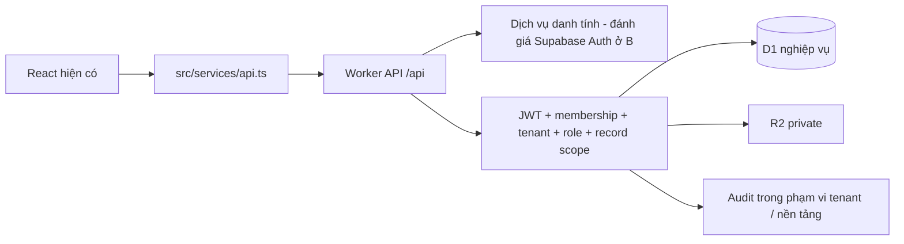

# KẾ HOẠCH HIỆN HÀNH — CLOUDFLARE WORKERS STATIC ASSETS FULL-STACK, MULTI-TENANT

Cập nhật 06/11/2026 theo [master prompt đã hợp nhất](cloudflare/MASTER_PROMPT.md). Đây là kế hoạch thay thế toàn bộ phương án backend cũ; không chỉ là chú thích bổ sung lên kế hoạch Supabase.

**Trạng thái thực tế:** Chặng A đã chuyển sang Workers Static Assets + Worker API theo yêu cầu mới ngày 06/11/2026 và kiểm tra local, chờ chủ sản phẩm nghiệm thu trước Preview. Chặng B–E chưa triển khai. Việc đồng bộ tài liệu không phải phê duyệt triển khai B, tạo database/tài khoản, push, migration remote hoặc deploy.

Đọc [bảng đối chiếu yêu cầu và tiến độ](cloudflare/REQUIREMENTS_TRACEABILITY.md), [hướng dẫn chạy/triển khai](cloudflare/README.md), [báo cáo Chặng A](qa/CLOUDFLARE_WORKERS_STAGE_A.md). Kế hoạch/prompt cũ được lưu tại [snapshot trước đồng bộ](archive/2026-11-06-before-master-sync/README.md).

## 1. Phạm vi và nguồn ưu tiên

- Tích hợp vào `D:\ubnd-huong-do-tasks`, repository `ntuan161297-eng/TheoDoiNhiemVu`; không tạo frontend/repository mới, không ghi đè local chưa push.
- Hương Đô là tenant triển khai đầu tiên. Sản phẩm đích hỗ trợ nhiều xã/phường/cơ quan; không giới hạn toàn nền tảng vào 11 đơn vị của một xã.
- Yêu cầu trực tiếp mới nhất của chủ sản phẩm và master Cloudflare quyết định kiến trúc, multi-tenant, vai trò, thứ tự A–E. PRD/UX/test V1.3 ưu tiên V1.2 về nghiệp vụ; CSV/Excel là nguồn danh mục và cấu trúc import.
- Không sửa repo tham khảo `VanPhongSo`, không mang dữ liệu/KPI/auth demo Hưng Yên hoặc phân hệ dự án/giải ngân/ngân sách sang.
- Không thay Vercel Production. Không cài phần mềm hệ thống, xóa dữ liệu, chạy SQL remote, deploy Production hoặc push khi chưa có phạm vi cho phép tương ứng. Không đưa văn bản thật/dữ liệu nội bộ lên môi trường demo Cloud.

## 2. Kiến trúc hiện hành và mức hoàn thành

| Thành phần | Công nghệ đích | Hiện tại |
|---|---|---|
| Frontend | React + TypeScript + Vite + Ant Design + Recharts; Design System sẵn có | UI hiện có được giữ nguyên |
| Hosting | Cloudflare Workers Static Assets, SPA routing | Cấu hình và local đã có; chưa deploy Cloud |
| API | Cloudflare Worker API, `worker/index.ts`, TypeScript tương thích Workers Runtime | Health JSON đã có; chưa Auth/middleware quyền hoặc API nghiệp vụ |
| Client | `src/services/api.ts`, gọi cùng origin `/api` | Đã tạo; chưa thay DemoProvider |
| Database | Cloudflare D1, SQL tương thích SQLite, migration có version | Chưa schema/migration D1 hoặc binding thật |
| File | R2 private; metadata/tenant scope trong D1; tải qua API có quyền | Chỉ contract/mẫu binding, chưa bucket/upload/download thật |
| Danh tính | Ưu tiên đánh giá Supabase Auth nếu an toàn và ít phát sinh | Chưa SDK/session/JWT thật; không tự lưu mật khẩu |
| Phân quyền | Worker API + membership/role/tenant + composite FK trong D1 | Chưa triển khai; middleware A chỉ mở health |

Không dùng Supabase PostgreSQL/Storage/RLS làm backend đích. Không dùng migration PostgreSQL trực tiếp cho D1. Supabase chỉ là lựa chọn dịch vụ danh tính ở B; không mặc định dùng service_role để bỏ qua kiểm tra quyền.

Sơ đồ là kiến trúc đích. Hiện chỉ health chạy qua API; các khối Auth/D1/R2/tenant guard chưa được nối.

## 3. Thiết kế đa Tenant phải hoàn thiện ở B

Mỗi cơ quan có tenant riêng và cơ cấu/đơn vị/lãnh đạo/nguồn/tài khoản/nhiệm vụ/văn bản/báo cáo/file riêng. Một identity có thể thuộc nhiều tenant; người dùng phải chuyển ngữ cảnh rõ ràng. Thay tenant phải tải lại quyền, xóa cache/selection không còn phù hợp, không trộn dữ liệu hai cơ quan.

### Danh sách bảng đích và quan hệ

| Bảng | Vai trò / phạm vi |
|---|---|
| `tenants` | Cơ quan, mã, tên, trạng thái, cấu hình riêng |
| `organization_units` | Cơ cấu dạng cây, mã đơn vị, parent cùng tenant, active; chống chu trình |
| `profiles` | Hồ sơ identity dùng chung; định danh từ provider/issuer/subject, không password |
| `tenant_memberships` | Membership của profile trong tenant, active/locked; unique cặp tenant/user |
| `tenant_member_roles` | Các role được cấp cho membership, audit người cấp/thu hồi |
| `user_unit_assignments` | Liên kết membership với đơn vị thuộc chính tenant đó |
| `leaders`, `task_sources` | Lãnh đạo/nguồn theo tenant, mã ổn định |
| `source_documents` | Văn bản căn cứ hoặc mô tả cuộc họp; một hồ sơ có nhiều nhiệm vụ |
| `tasks` | Một nguồn, một chủ trì, một lãnh đạo, hạn gốc/hạn hiệu lực, tiến độ/kết quả/snapshot/version |
| `task_coordinating_units` | Nhiều đơn vị phối hợp, không trùng chủ trì; không nhân bản task |
| `task_progress_updates` | Cập nhật tiến độ và minh chứng |
| `expedite_documents` | Văn bản đôn đốc, trạng thái hủy/đính chính có lịch sử |
| `expedite_document_tasks` | Một văn bản liên kết nhiều nhiệm vụ, duy nhất cặp văn bản/task |
| `extension_requests` | Hồ sơ đề nghị + phản hồi + kết quả/hạn duyệt, nhiều lần tuần tự |
| `attachments` | Metadata, owner/document, tenant, object key R2, trạng thái upload/kiểm tra |
| `audit_logs` | Actor, tenant/scope, hành động, trước/sau, lý do, thời điểm; không xóa trái phép |
| `import_jobs`, `import_job_rows` | File/preview/errors/lựa chọn trùng và kết quả từng dòng trong đúng tenant |

Bổ sung cơ chế role nền tảng/Bootstrap Super Admin và idempotency theo thiết kế B; không dùng role tenant để suy ra quyền Super Admin. `profiles` là identity dùng chung, còn dữ liệu/quyền của cơ quan thuộc membership/tenant; quyết định schema chi tiết phải được review trước khi tạo D1 migration.

Mọi bảng nghiệp vụ tenant-scoped có `tenant_id`; dùng unique/index theo tenant, composite FK như `(tenant_id, source_document_id) -> source_documents(tenant_id,id)` và tương tự cho task/đơn vị/văn bản/attachment/membership. Không chỉ lọc tenant ở UI hoặc chỉ kiểm tra một FK `id`. Đơn vị cha cũng phải cùng tenant. Profile toàn cục không được chứa task/file hoặc quyền nội bộ của một tenant.

Ví dụ chống truy cập chéo bắt buộc kiểm thử ở B: người A gửi tenant B, đổi task ID/document ID/file ID sang B, gắn đơn vị B vào nhiệm vụ A, báo cáo/export/import xuyên tenant, đổi tenant nhưng dùng cache/token/quyền cũ. Không được chỉ test các trường hợp hợp lệ.

Seed Hương Đô: đúng 11 đơn vị, 3 lãnh đạo và 3 nguồn từ CSV, scoped tenant Hương Đô. Giữ mã/tên chính thức, normalize hoa-thường/Unicode khi đối chiếu; không tự tạo đơn vị thứ 12. Cơ quan khác có cơ cấu riêng, không tự sao chép 11 đơn vị Hương Đô cho tất cả tenant. Không tự tạo tài khoản cho các đơn vị từ CSV, nhiệm vụ giả hoặc tenant A/B thật trên Cloud.

## 4. Danh tính, ma trận quyền và quản trị

Mỗi API đọc/ghi/thống kê/export/tải file phải thực hiện: (1) xác minh danh tính/token hợp lệ; (2) membership còn hiệu lực; (3) tenant được cấp quyền; (4) role có capability cần thiết; (5) bản ghi và mọi liên kết thuộc tenant; (6) ghi audit khi thay đổi dữ liệu/đặc quyền. Tenant header chỉ là yêu cầu chọn ngữ cảnh, không phải bằng chứng cấp quyền.

Không tin role DEMO, `user_metadata`, tenant_id từ body hoặc việc ẩn nút ở frontend. D1 không có PostgreSQL RLS; Worker API phải thực thi quyền, D1 composite FK/constraints bổ sung bảo vệ tính nhất quán. Không viết hệ thống hash/mật khẩu/reset token thủ công.

| Vai trò | Quyền theo master | Ranh giới |
|---|---|---|
| Super Admin | Tạo/quản lý tenant; tạo Tenant Admin; theo dõi trạng thái tenant; cấu hình nền tảng | Không mặc định đọc nhiệm vụ/văn bản/file nội bộ tenant |
| Tenant Admin | TreeView/cơ cấu; thêm/sửa/ngừng đơn vị; tạo tài khoản/invite; cấp/thu hồi role; khóa quyền tenant; yêu cầu reset; audit quản trị được phép | Chỉ trong tenant được cấp; không quản trị tenant khác hoặc tự thành Super Admin |
| Office Editor | Thêm/sửa task; cập nhật tiến độ; ghi đôn đốc và đề nghị gia hạn | Không tự suy ra quyền xác nhận hoặc duyệt hạn |
| Office Confirmer | Xác nhận hoàn thành; ghi quyết định gia hạn có căn cứ thẩm quyền | Lưu actor và snapshot; không phải cơ quan tự ban hành quyết định hành chính |
| Leader Viewer | Xem dashboard/task/báo cáo/tài liệu được phép | Không sửa dữ liệu |

Một người có thể có nhiều role theo từng tenant. Việc kế thừa capability giữa Tenant Admin/Editor/Confirmer phải chốt minh bạch ở B; không mang ma trận ADMIN đơn cơ quan của Supabase cũ sang rồi mặc định mở mọi dữ liệu. Phân công đơn vị không tự tạo quyền ghi.

Nếu chọn Supabase Auth: frontend dùng SDK danh tính, backend xác minh token/issuer/audience/expiry và cơ chế khóa/thu hồi phù hợp; quyền tenant đọc từ D1. Tạo user/invite/reset qua API quản trị identity phía server và kiểm tra role trước; secret chỉ ở server, không vào `VITE_*`, browser, logs hoặc Git. Bootstrap Super Admin riêng, có xác minh người vận hành và audit; không tự cấp cho user đăng ký đầu tiên.

## 5. UI, tài liệu và file phải bảo toàn

Giữ Design System/nav/header navy, login, Dashboard, 6 KPI, bảng/filter, form, Drawer 5 tab, import wizard và lịch/giờ Việt Nam. Không tạo frontend mới. Giữ `src/App.tsx`, `store.tsx`, `demo.ts`, `domain.ts`, `pages.tsx`, Login/TaskForms/TaskDrawer/ImportWizard/BusinessClock; thay lớp dữ liệu từng bước, không viết lại component khi chưa cần.

Năm trang nghiệp vụ + login tiếp tục là giao diện công việc. Master bổ sung vùng quản trị hệ thống/tenant, Tenant TreeView và cơ cấu ở C; không dùng giới hạn 5 trang cũ để bỏ các yêu cầu quản trị mới. TreeView chưa có trong bản A; không báo đã bảo toàn một chức năng chưa tồn tại. Giữ ngày/tháng/giờ Asia/Ho_Chi_Minh; âm lịch chỉ thêm khi có cách tính/kiểm thử chính xác, không hiển thị số giả.

R2 private, object key gắn tenant và metadata trong D1. Download phải qua kiểm tra identity/membership/role/tenant/record scope, không trả đường dẫn public cố định. Upload kiểm tra MIME/đuôi/size/nội dung ở server, lifecycle pending/ready, chống ghi đè chứng cứ. D1 và R2 không phải một transaction chung; cần retry/dọn orphan và audit, không coi metadata tồn tại là file đã upload/backup thành công.

## 6. Quy tắc nghiệp vụ không thay đổi

- Ba nguồn chính; một chủ trì + nhiều phối hợp; lãnh đạo chỉ đạo; mỗi nhiệm vụ một ID duy nhất trong tenant.
- Hạn gốc bất biến. Hạn hiệu lực từ quyết định gia hạn hợp lệ gần nhất; pending/rejected không đổi hạn, kể cả lần 2 sau lần 1 approved. Chỉ một pending/task.
- Ngày lịch Việt Nam: `daysLeft = effectiveDue - businessToday`; >=6 còn hạn, 3..5 nguy cơ, 0..2 khẩn, <0 quá hạn. Ngày đến hạn vẫn đúng hạn cả ngày. Trạng thái thực hiện/hạn/gia hạn độc lập.
- Một văn bản đôn đốc nhiều task; count theo liên kết hợp lệ không hủy. Mở/sửa/tải lại không tăng lượt. Không tự phát hành/gửi văn bản hoặc đổi hạn/status khi đôn đốc.
- Hoàn thành phải có ngày thực tế hợp lệ, kết quả, người có quyền xác nhận và timestamp server; snapshot hạn tại thời điểm xác nhận, phân loại đúng/chậm theo snapshot, không hồi tố âm thầm. 100% không tự hoàn thành.
- KPI từ DISTINCT task ID trong tenant và cùng bộ lọc/asOf; thống kê theo chủ trì, phối hợp chỉ dùng tra cứu. Tổng = hoàn thành + chưa hoàn thành; cảnh báo là tập con chưa hoàn thành; gia hạn/đôn đốc có thể giao các nhóm khác. Không hardcode số dashboard.
- Import .xlsx 3 bước, chỉ NHAP_NHIEM_VU, header dòng 5/data từ 6, 19 cột; không tự nhập VI_DU/DANH_MUC. Preview/lỗi dòng-cột/nghi trùng/chọn chính sách trước khi ghi; kiểm tra lại backend khi xác nhận. Giữ hạn gốc và lịch sử. Không tự tạo file/đôn đốc/gia hạn từ Excel.
- Ghi liên bảng phải nguyên tử theo khả năng D1 transaction/batch đã kiểm thử; optimistic version, idempotency và audit cùng thay đổi. Không suy ra rằng các request API rời rạc là một transaction. Thiết kế B/D phải chứng minh không ghi một phần khi guard/version thất bại.

## 7. Workers Static Assets và môi trường

Yêu cầu mới nhất [Chặng A Worker](cloudflare/STAGE_A_WORKERS_REQUEST.md) thay cấu hình Pages cũ. `wrangler.jsonc` dùng Worker `theodoinhiemvu`, `main=worker/index.ts`, compatibility date 2026-11-06, assets `dist`, binding `ASSETS`, SPA fallback. `run_worker_first=["/api","/api/*"]` buộc mọi API qua Worker, kể cả navigation. Không dùng `_routes.json`, `pages_build_output_dir`, Pages Functions hoặc Cloudflare Vite plugin. Mã Pages cũ được lưu tại `docs/archive/2026-11-06-before-workers` và ZIP backup.

Health chỉ trả `{"status":"ok","service":"theo-doi-nhiem-vu-api"}`, JSON UTF-8/no-store. API chưa có trả 404 JSON, method health không hỗ trợ trả 405. Health không phải kiểm tra readiness D1/R2/Auth. Client service đã chuẩn bị; DemoProvider/login và nghiệp vụ vẫn mô phỏng.

Local `npm run dev:worker`, địa chỉ 127.0.0.1:8788, chạy workerd thật và override APP_ENV=development. Theo A.2 dùng Worker Previews với khối `previews` thật: APP_ENV=preview, D1/R2 rỗng; không named env.preview hoặc Version URLs làm thay thế. Wrangler 4.157.0 đáp ứng >=4.135.0; `npm run preview:worker` gọi `wrangler preview --ignore-base-config`. Máy chưa đăng nhập và Builds chưa xác minh nên chưa push/deploy. D1/R2/Auth thật chưa có; không dùng tài nguyên Production cho test.

Vercel giữ nguyên. Không deploy/push trong lượt này. Nhánh A.2 `feature/cloudflare-worker-stage-a` chỉ được push sau khi xác nhận repo/branch control/Preview command an toàn. Preview dùng `wrangler preview`, không deploy/versions upload; tên parent Worker vẫn `theodoinhiemvu`. Chi tiết tại [hướng dẫn A.2](cloudflare/WORKER_PREVIEWS_A2.md).

## 8. Lộ trình A–E và tiêu chí nghiệm thu

| Chặng | Bàn giao đầy đủ | Điều kiện nghiệm thu | Hiện tại |
|---|---|---|---|
| A — Hạ tầng | Kiểm tra local/GitHub; ưu tiên local; ZIP/branch/checkpoint; công cụ project; Workers Static Assets/Worker API; health; service client; UI Mock nguyên vẹn | Build/typecheck, API và frontend chung origin local; test cũ đạt; báo file/URL/hướng dẫn Dashboard | Đã làm local, chờ chủ sản phẩm nghiệm thu |
| B — Database/quyền | D1 schema đa tenant, versioned SQLite migration/seed Hương Đô; identity/JWT; membership/role; test tenant A/B; bootstrap Super Admin | Local DB tồn tại qua restart; composite FK/permission chặn truy cập chéo; không tự nâng quyền; không tự cấp data access cho Super Admin | Chưa triển khai; chỉ bắt đầu sau duyệt A |
| C — Quản trị | Tenant TreeView/cơ cấu; tài khoản, role, invite/reset/revoke/lock; audit quản trị đúng phạm vi | API và UI cùng capability, không sửa tenant khác, thu hồi quyền có hiệu lực, không lộ password/secret, không Super Admin đọc data nội bộ mặc định | Chưa triển khai |
| D — Nghiệp vụ | CRUD thật; tiến độ/hoàn thành; KPI/report; đôn đốc/gia hạn; import/export Excel; R2 file | V1.3 từ đầu đến cuối qua API; backend thực thi hạn/snapshot; transaction/version/retry; số liệu khớp; file có quyền | Chưa triển khai; UI hiện chỉ mô phỏng |
| E — QA/triển khai | Test tự động, xuyên tenant, backup/restore D1+R2; Worker Preview; dữ liệu test; Production sau duyệt | Kiểm thử và khôi phục DB lẫn file; build/test đạt; không blocker; PO duyệt riêng Production | Chưa triển khai |

Chặng A đã có 28 unit tests và 9 browser tests trong [báo cáo A](qa/CLOUDFLARE_WORKERS_STAGE_A.md). Kết quả đó không nghiệm thu D1/Auth/tenant isolation hoặc nghiệp vụ lưu thật. Đưa token vào request không biến middleware A thành Auth thật.

## 9. Hướng dẫn tiếp tục và điều kiện dừng

- Yêu cầu trực tiếp mới nhất và master đã hợp nhất là chuẩn yêu cầu. Dùng [bảng truy vết](cloudflare/REQUIREMENTS_TRACEABILITY.md) để xác định phần nào có code, phần nào chỉ được ghi vào kế hoạch.
- `prompts/00_PHAN_TICH_TRUOC_KHI_CODE.md`: phân tích thay đổi trên ứng dụng hiện có; không khởi tạo mới.
- `prompts/01_DUNG_GIAO_DIEN_MAU.md`: bảo toàn/kiểm tra UI sẵn có; `01A_CLOUDFLARE_WORKERS_HA_TANG.md`: Chặng A.
- `prompts/02_TAO_DATABASE_API_DANG_NHAP.md`: B D1/Auth/multi-tenant; `02C_QUAN_TRI_TENANT.md`: C.
- `prompts/03_IMPORT_DON_DOC_GIA_HAN.md`: toàn bộ D; `04_KIEM_THU_NGHIEM_THU.md`: E.
- Chưa duyệt A thì không chạy prompt B như một lệnh thực thi. Không coi nhận xét tài liệu còn thiếu là phê duyệt làm B–E.
- Các file Supabase PostgreSQL cũ giữ nguyên làm lịch sử/tham khảo nghiệp vụ; không apply vào D1, không tự cài SQL Server/.NET và không sử dụng bảng/quyền đơn cơ quan cũ làm backend đích.
