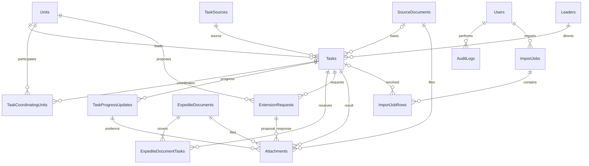

# KẾ HOẠCH TRIỂN KHAI — THEO DÕI VÀ ĐÔN ĐỐC NHIỆM VỤ UBND XÃ HƯƠNG ĐÔ

> **Cập nhật hiện hành 06/11/2026:** Chủ sản phẩm yêu cầu tích hợp **Cloudflare Pages + Pages Functions**, database đích **D1**, file **R2 private**, mở rộng đa Tenant; Supabase chỉ được cân nhắc làm Auth. **Chặng A đã tích hợp/kiểm tra local, chờ nghiệm thu; chưa bắt đầu B.** [Hướng dẫn chạy và triển khai](cloudflare/README.md), [báo cáo A](qa/CLOUDFLARE_STAGE_A.md). Các phần Supabase và chặng 1–4 bên dưới là kế hoạch lịch sử trước quyết định mới, không cấp quyền chạy migration/deploy. Lộ trình mới: A hạ tầng → B D1/Auth/tenant isolation → C quản trị → D nghiệp vụ → E QA/Preview/Production có duyệt. Giữ toàn bộ quy tắc nghiệp vụ V1.3.

Trạng thái cập nhật 05/11/2026: Chặng 1 UI mock đã hoàn thành và được chủ sản phẩm nghiệm thu. Chủ sản phẩm đã duyệt kiến trúc **Supabase**, thay ASP.NET Core/EF Core/SQL Server, và cho phép **Bước 2.2 tạo file migration/seed/SQL tests, kiểm thử tĩnh**. Bộ SQL đã tạo trong `supabase/`; **chưa chạy SQL, link Cloud, tạo Admin hoặc nối Auth/CRUD/Dashboard vào frontend**. Chờ phê duyệt chạy migration; Chặng 3–4 tiếp tục cần duyệt riêng.

Thiết kế đã duyệt: [STAGE2_SUPABASE_ARCHITECTURE.md](analysis/STAGE2_SUPABASE_ARCHITECTURE.md). Bàn giao Bước 2.2: [báo cáo migration](qa/STAGE2_MIGRATION_REVIEW.md), [hướng dẫn áp dụng](../supabase/README.md). Báo cáo môi trường .NET/SQL cũ chỉ còn giá trị lịch sử, không là điều kiện chặn hướng Supabase.

## 1. Nguồn và thứ tự ưu tiên

Đã đọc toàn bộ docs/product: 00_DOC_TRUOC, 00_START_HERE, PRD/UX V1.2 và V1.3, business rules, kiểm thử V1.2/V1.3, audit GitHub, ba CSV, workbook Excel và các reference. Khi khác nhau: V1.3 ưu tiên hơn V1.2. Yêu cầu trực tiếp của chủ sản phẩm xác định lãnh đạo mặc định chỉ xem, Văn phòng nhập và xác nhận.

Repository ntuan161297-eng/VanPhongSo chỉ dùng nghiên cứu. Tự viết mã React/Ant Design theo ý tưởng bố cục; không sao chép mã khi chưa xác định quyền sử dụng, không sửa repo nguồn, không mang mock/KPI/auth demo Hưng Yên sang.

## 2. Phạm vi MVP — năm trang và đăng nhập

1. Tổng quan và cảnh báo: sáu KPI, danh sách ưu tiên, thống kê 11 đơn vị, một biểu đồ.
2. Nhiệm vụ: tìm/lọc, thêm/sửa, tiến độ, hoàn thành, import/export; drawer chi tiết năm tab.
3. Cần đôn đốc: quá hạn → khẩn → nguy cơ; một văn bản liên kết nhiều nhiệm vụ.
4. Báo cáo theo đơn vị: 11 dòng kể cả số 0, drill-down, xuất tổng hợp/chi tiết theo bộ lọc.
5. Danh mục/cấu hình: 11 đơn vị, ba lãnh đạo, ba nguồn; tài khoản/quyền ở giai đoạn backend.

Không làm tài khoản phòng chuyên môn, giao nhận điện tử, workflow đa cấp, chữ ký số, SSO, văn thư tích hợp, AI, email/SMS/Zalo, app native, đầu việc con, dự án/giải ngân/ngân sách/bản đồ.

## 3. Vai trò và quy trình

| Hành động | Văn phòng nhập liệu | Văn phòng xác nhận | Lãnh đạo xem | Quản trị |
|---|---|---|---|---|
| Xem/lọc/xuất | Có | Có | Có | Có |
| Nhập/sửa/tiến độ/đôn đốc/đề nghị gia hạn | Có | Có | Không | Có (đề xuất Supabase) |
| Ghi kết quả gia hạn, xác nhận hoàn thành | Không | Có | Không | Có (đề xuất Supabase) |
| Tài khoản/danh mục/cấu hình | Không | Không | Không | Có |
| Xóa audit | Không | Không | Không | Không |

Tiếp nhận căn cứ → nhập tay hoặc import → cập nhật tiến độ → hệ thống tính hạn → ghi văn bản đôn đốc/đề nghị gia hạn → ghi kết quả có căn cứ → xác nhận hoàn thành → báo cáo. Đơn vị trao đổi ngoài hệ thống. Ghi nhận chấp thuận không trao thẩm quyền hành chính cho Văn phòng.

## 4. Sitemap và UX

Header navy #153B60, menu ngang, nền #F3F7FB, card trắng, tương tác xanh #1677FF. Desktop từ 1280px sáu KPI/hàng khi đủ chỗ, tablet ba KPI/hàng, mobile hai KPI/hàng. Bảng cuộn ngang trong vùng riêng; form/drawer toàn màn hình trên điện thoại. Body khoảng 14px, trạng thái có chữ và màu, keyboard/focus, loading/empty/error/retry rõ ràng.

Menu: Tổng quan | Nhiệm vụ | Cần đôn đốc | Báo cáo đơn vị | Danh mục. Đăng nhập riêng. Thêm/sửa/import là luồng trong trang, không tăng số trang nghiệp vụ.

Form nhiệm vụ: nguồn/căn cứ; nội dung/ngày giao/chủ trì/lãnh đạo bắt buộc; phối hợp tùy chọn không trùng chủ trì; hạn gốc bắt buộc; ưu tiên, lĩnh vực/người theo dõi/ghi chú tùy chọn. Mã tự sinh. Hạn gốc không ghi đè sau lưu. % tiến độ tùy chọn, không tự xác nhận khi 100%.

Drawer: Thông tin | Tiến độ | Đôn đốc | Gia hạn | Lịch sử. Timeline có người/thời điểm/trước-sau/tài liệu. Lưu bộ lọc khi drill-down và quay lại.

Import ba bước: chọn .xlsx → xem trước và lỗi dòng/cột/nghi trùng → xác nhận/kết quả. Workbook gồm HUONG_DAN, NHAP_NHIEM_VU, VI_DU, DANH_MUC; chỉ nhập NHAP_NHIEM_VU, header dòng 5, dữ liệu từ 6, 19 cột A–S. Vùng mẫu đến dòng 205 chưa phải giới hạn sản phẩm. Sheet nhập hiện trống; không tự nhập ba dòng VI_DU. Phối hợp tách bằng |. Chuẩn hóa Unicode/khoảng trắng/hoa-thường (Công an trong CSV và Excel cùng DV06), không fuzzy-match hoặc tự tạo danh mục.

Trùng: ưu tiên mã đối chiếu duy nhất; nếu thiếu dùng nguồn + số/ngày văn bản + nội dung + chủ trì để cảnh báo. Mặc định bỏ qua; cập nhật chỉ khi định danh chắc chắn; không sửa hạn gốc/lịch sử. Có lỗi chặn thì chưa ghi; xác nhận xong backend kiểm tra lại và transaction. Dòng hoàn thành phải đủ dữ liệu và quyền xác nhận. Excel không tạo file, đôn đốc hoặc gia hạn.

Đôn đốc: 1..N nhiệm vụ, số/ngày văn bản, cơ quan/người ký, nội dung, hạn phản hồi tùy chọn, file và ghi chú. Một hồ sơ dùng chung; mở/sửa/tải lại file không tăng lượt. Nhắc nội bộ nếu có là chỉ tiêu riêng, mặc định chưa bật.

Gia hạn: hiển thị hạn gốc/hạn hiện tại/hạn đề nghị/số ngày xin thêm; số/ngày/đơn vị/lý do/hạn đề xuất/file; pending giữ hạn. Kết quả cần số/ngày văn bản và file; approved nhập hạn được duyệt có thể khác hạn xin. Chỉ một yêu cầu đang chờ trên mỗi nhiệm vụ.

## 5. Kiến trúc và ERD

Frontend giữ React + TypeScript + Vite + Ant Design + Recharts, toàn bộ UI hiện có. Backend đích: Supabase PostgreSQL + Auth + Storage private + RLS; đọc qua Data API có grants/RLS, ghi liên bảng bằng PostgreSQL RPC transaction và audit. Edge Functions chỉ dùng khi cần xử lý phía server, không thay transaction DB. Không cài .NET/SQL Server, không tạo frontend mới.

ERD dưới đây thể hiện quan hệ nghiệp vụ tổng quát. ERD PostgreSQL chi tiết, `auth.users`/`profiles`/`user_roles`, bảng idempotency, khóa/index, Storage và ma trận RLS nằm tại [thiết kế Supabase](analysis/STAGE2_SUPABASE_ARCHITECTURE.md). Mọi thông tin người dùng/quyền được kiểm tra tại DB; frontend chỉ dùng publishable key, không chứa secret/service_role. Chỉ seed danh mục chính thức 11/3/3; không tự đưa nhiệm vụ DEMO hay dữ liệu nội bộ lên Cloud.

Tasks: UUID/code/externalRef, source/primaryUnit/leader/document, content/assignedDate/originalDueDate, executionStatus, owner/priority, completedDate/confirmedAt/confirmedBy/completionSummary/dueDateAtCompletion, rowVersion. Danh mục có ID ổn định và active. Các bảng phối hợp và liên kết đôn đốc có khóa cặp duy nhất.

SourceDocuments lưu số/ngày/cơ quan/trích yếu hoặc mô tả cuộc họp. ExpediteDocuments lưu văn bản, yêu cầu, hạn phản hồi, tình trạng hủy/lý do. ExtensionRequests lưu thứ tự, hạn trước khi xin, văn bản đề nghị, hạn xin, kết quả, văn bản phản hồi và hạn được duyệt. Attachments có metadata/hash/storageKey và đúng một chủ thể, phân biệt file đề nghị/phản hồi. AuditLogs append-only lưu trước/sau/người/thời điểm/lý do. ImportJobs/Rows lưu tên/hash tệp, lỗi, lựa chọn trùng và kết quả từng dòng.

Date dùng ngày nghiệp vụ; timestamp audit UTC, hiển thị giờ Việt Nam. Hạn hiệu lực dẫn xuất; nếu cache trong Tasks phải cập nhật cùng transaction. Một yêu cầu pending/task được ràng buộc DB. Optimistic concurrency, chống gửi lặp, kiểm tra quyền API, thống kê dùng chung service.

## 6. Quy tắc hạn và KPI

Ngày lịch Asia/Ho_Chi_Minh. daysLeft = hạn hiệu lực − hôm nay. Chưa hoàn thành: >=6 Còn hạn; 3..5 Nguy cơ; 0..2 Khẩn; <0 Quá hạn. Đến hạn vẫn đúng hạn cả ngày. Không có hạn là dữ liệu không hợp lệ.

Thực hiện: CHUA_THUC_HIEN/DANG_THUC_HIEN/DA_HOAN_THANH. Hạn và gia hạn là các trục độc lập. Gia hạn: KHONG_XIN/DANG_XIN/DA_DUOC_GIA_HAN/KHONG_DUOC_CHAP_THUAN. Lần tiếp theo pending/rejected giữ hạn đã duyệt trước đó. Không dùng max(hạn đề nghị) hoặc ngày nhập mới nhất để suy quyết định.

Hạn hiệu lực = hạn gốc nếu chưa duyệt; nếu có dùng hạn được duyệt ở lần áp dụng hợp lệ gần nhất. Đề xuất mới phải sau hạn hiện tại; giảm hạn là nghiệp vụ khác. OriginalDueDate bất biến. Xác nhận hoàn thành cần ngày thực tế <= hôm nay, kết quả, người xác nhận; chụp dueDateAtCompletion. Thực tế <= snapshot: đúng hạn, >: chậm. Sau hoàn thành bỏ cảnh báo quá hạn hiện hành; không hồi tố snapshot bằng sửa hạn.

T = DISTINCT Task ID trong bộ lọc. Tổng = Hoàn thành + Chưa hoàn thành. Chưa hoàn thành = Còn hạn + Nguy cơ + Khẩn + Quá hạn. Hoàn thành = Đúng hạn + Chậm hạn. Pending gia hạn và đã đôn đốc là các tập có thể giao, không cộng vào tổng. Nhiệm vụ đã đôn đốc đếm Task ID có văn bản hợp lệ; tổng lượt đếm liên kết. Một văn bản bốn nhiệm vụ = một văn bản/bốn lượt/mỗi nhiệm vụ một lần.

Thống kê theo đơn vị chủ trì, đủ 11 đơn vị kể cả 0; phối hợp chỉ lọc tra cứu. Năm/tháng mặc định theo ngày giao. Khác trường AND, cùng trường nhiều giá trị OR. Drill-down giữ bộ lọc. Dashboard/danh sách/export cùng tập dữ liệu và asOf.

## 7. Tham khảo GitHub

AppHeader/AppLayout: cấu trúc header/menu; KPICard: thẻ có keyboard; FilterBar: flex/filter nâng cao; StatusBadge: Tag; TaskListPage/TaskDetailDrawer: Table/Descriptions/Drawer/Timeline; TaskOverviewMode: bố cục KPI/bảng/Recharts. Tự viết phiên bản Hương Đô. dataService.ts và TaskOverviewMode có số hardcode/mock; expediteTask sửa mảng runtime; AppContext dùng auth demo. Không tái sử dụng logic này. Viết mới DTO/thuật toán/API/auth/persistence/import/đôn đốc/gia hạn/file/audit/export.

## 8. Bốn chặng và nghiệm thu

| Chặng | Bàn giao | Điều kiện |
|---|---|---|
| 1 UI mock (đã hoàn thành) | 5 trang + login, form/drawer/import 3 bước/đôn đốc/gia hạn; nhiệm vụ DEMO trong bộ nhớ | KPI tính động, drill-down đúng, đủ 11 đơn vị, responsive desktop/tablet/mobile, build và browser QA đã có minh chứng |
| 2 Supabase DB/Auth/RLS (2.2 đã tạo SQL, chờ duyệt apply) | PostgreSQL migration có version/seed 11-3-3/RLS/RPC/schema Storage; các bước Auth/service React/CRUD/dashboard sau apply cần triển khai tiếp theo phạm vi duyệt | Tĩnh đã kiểm tra; runtime DB quyền/concurrency/persistence/snapshot/báo cáo chưa chạy; không seed demo |
| 3 Import/Đôn đốc/Gia hạn (chưa được phép) | Import thật/preview/log/transaction, văn bản chung, kết quả gia hạn | TC08–15/19–22/29 V1.3; không nhân bản; pending/rejected giữ hạn; approved nguyên tử |
| 4 QA (chưa được phép) | Test tự động/UI/hướng dẫn/backup-restore | TC01–30 V1.3 và test nền V1.2 phù hợp; build/test đạt; phục hồi DB và file; không mock |

Chỉ chuyển chặng sau khi kiểm tra và PO chấp thuận. Bước 2.2 chỉ tạo SQL và kiểm thử tĩnh, cài parser PostgreSQL dev dependency trong project; chưa chạy migration/nối Supabase. Không tự deploy hoặc push các thay đổi này. Lần push mã trước đó được chủ sản phẩm yêu cầu riêng, không phải quyền tự push ở các lượt sau.

## 9. Quyết định còn cần chốt trước các chặng sau

Các quyết định còn mở hiện hành được tập trung tại mục 10 của [thiết kế Supabase](analysis/STAGE2_SUPABASE_ARCHITECTURE.md): project thử nghiệm/người phụ trách; ma trận quyền chi tiết; giới hạn file; workflow migration và môi trường DB tests; trước GĐ3 chốt đính chính gia hạn và quy mô import. Không còn yêu cầu chọn/cài máy chủ .NET/SQL để tiếp tục.

## 10. Môi trường đã kiểm tra

Node v22.14.0, Git 2.56.0.windows.1; .NET runtime có nhưng SDK chưa có; chưa phát hiện instance/dịch vụ SQL Server cục bộ, sqlcmd/sqllocaldb chưa có trong PATH. Chưa kiểm tra SQL Server từ xa. Không tự cài môi trường backend.

Kiểm tra Supabase trước Bước 2.2: chưa có client/config/migration/env/CLI. Nay đã tạo cấu trúc `supabase/config.toml`, sáu migrations, SQL tests/verification và hướng dẫn, cài parser dev dependency. Chưa cài Supabase client/CLI, chưa có cấu hình Cloud/secret hoặc linked project; chưa truy cập Cloud. Cấu hình local không tự thay cài đặt Dashboard.
