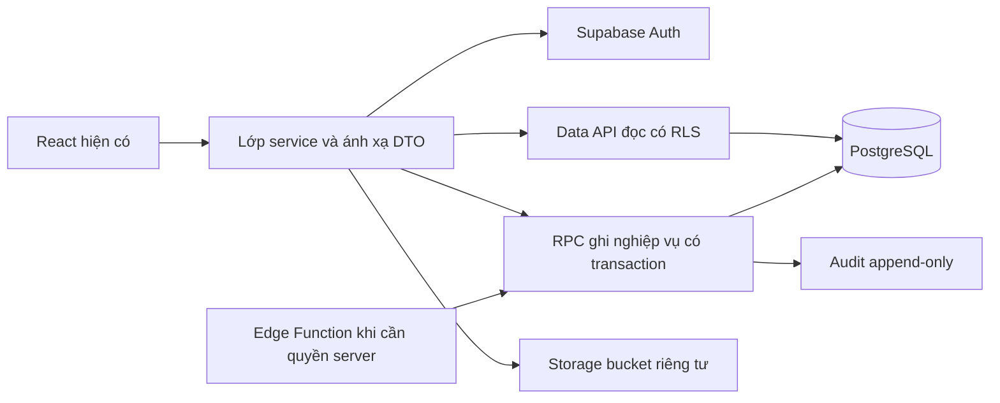
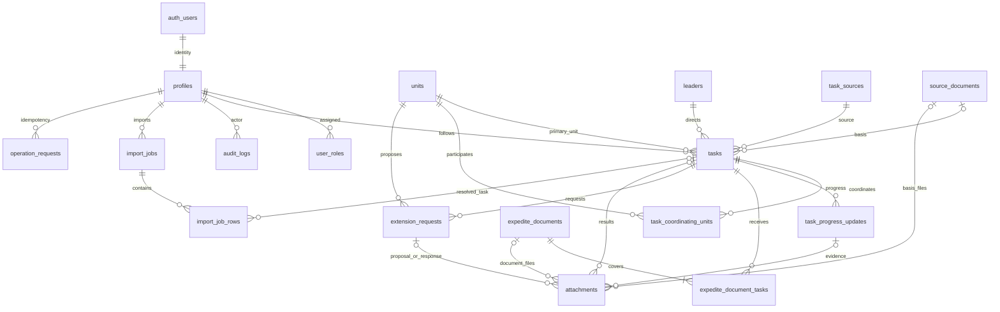

# GIAI ĐOẠN 2 — ĐỀ XUẤT KIẾN TRÚC SUPABASE

> **Đã được thay thế về nền tảng bởi yêu cầu Cloudflare Pages/Functions + D1 + R2.** Tài liệu này giữ làm lịch sử thiết kế nghiệp vụ. Không chuyển PostgreSQL RPC/RLS sang D1 nguyên trạng. Supabase Auth chỉ là phương án danh tính cần đánh giá ở Chặng B. Kế hoạch hiện hành và giới hạn ở [hướng dẫn Cloudflare](../cloudflare/README.md).

Ngày: 05/11/2026. **Kiến trúc đã được chủ sản phẩm duyệt; Bước 2.2 đã tạo file SQL và kiểm thử tĩnh.** Chưa chạy migration, kết nối Cloud, tạo tài khoản, đổi frontend, commit/push hoặc deploy. Nội dung bên dưới giữ thiết kế và kết quả khảo sát ban đầu; tiến độ thực tế và các chi tiết triển khai Bước 2.2 xem [báo cáo migration](../qa/STAGE2_MIGRATION_REVIEW.md), [hướng dẫn Supabase](../../supabase/README.md). Phải chờ phê duyệt riêng trước khi apply SQL.

## 1. Căn cứ, phạm vi và tình trạng cấu hình

- Nghiệp vụ theo toàn bộ PRD/UX, business rules, kiểm thử trong `docs/product`; V1.3 ưu tiên V1.2. Yêu cầu Supabase mới nhất thay phần công nghệ ASP.NET/EF Core/SQL Server trong tài liệu cũ, không thay quy tắc nghiệp vụ.
- Đã đối chiếu ba CSV chính thức và cấu trúc Excel: bốn sheet, chỉ đọc `NHAP_NHIEM_VU`, header dòng 5, dữ liệu từ 6, 19 cột A–S. Reference HTML/ảnh là minh họa UI, không phải dữ liệu seed.
- Giữ ứng dụng React/TypeScript/Vite/Ant Design/Recharts, theme, năm trang, login, drawer và biểu mẫu hiện có. Không tạo frontend mới. Phòng chuyên môn không có tài khoản.
- Hiện `src/store.tsx`/`src/demo.ts` dùng bộ nhớ; chưa có Supabase client. Không phát hiện `@supabase/supabase-js` trong package/lockfile, thư mục `supabase/`, `.env.local`, `.env.example`, biến môi trường có tên Supabase hoặc lệnh `supabase` trong PATH.
- Không có connector Supabase trong các công cụ đang kết nối. **Chưa thể xác nhận người dùng đã tạo project trên Cloud hay chưa**, chưa truy cập Dashboard hay kiểm tra database từ xa. Không in/thu thập giá trị khóa.
- Không cần cài .NET SDK, SQL Server, SSMS hay Docker cho phương án dùng project thử nghiệm Cloud. Công cụ migration sẽ được chọn và kiểm tra ở bước triển khai, không tự cài lúc này.
- Cloud chỉ chứa danh mục được cho phép và dữ liệu thử nghiệm do người dùng chủ động nhập. Không tự nạp `createDemo()`, sheet `VI_DU`, văn bản thật hoặc dữ liệu nội bộ. Chưa được phép seed nhiệm vụ minh họa.

## 2. Kiến trúc đích và ranh giới chặng

Giai đoạn 2 sau duyệt: schema đầy đủ, migration, seed 11/3/3, Auth, vai trò/RLS, CRUD nhiệm vụ và văn bản căn cứ, phối hợp, tiến độ, xác nhận hoàn thành, tài liệu, audit, lọc/KPI/báo cáo từ DB. Chuẩn bị bảng và quy tắc bảo vệ đôn đốc/gia hạn/import nhưng chưa bật nghiệp vụ ghi của Giai đoạn 3. Chưa có RPC tương ứng thì mặc định không có đường ghi.

Giai đoạn 3 phải được duyệt riêng: import Excel thật, văn bản đôn đốc nhiều nhiệm vụ, đề nghị/kết quả gia hạn và xử lý hủy/đính chính. Giai đoạn 4: QA toàn diện, khôi phục DB và file. Không tự chuyển chặng.

Edge Functions chỉ thêm khi cần: quản lý Auth user từ ứng dụng, kiểm tra file phía server, xử lý import lớn. Một Edge Function gọi nhiều API riêng lẻ không tạo transaction DB; thay đổi liên bảng vẫn gọi một RPC. Không cần thêm Express/.NET proxy chỉ để chuyển tiếp truy vấn.

## 3. ERD đề xuất

Các liên kết attachments là **loại trừ nhau**: mỗi file đã hoàn tất gắn đúng một chủ thể, không phải đồng thời gắn mọi bảng. Quan hệ người thực hiện audit có thể rỗng đối với sự kiện hệ thống. `auth_users` trong hình là bảng quản lý sẵn `auth.users`, không tự tạo bảng mật khẩu. Mỗi người đã provisioning có một profile; người chưa provisioning không có quyền dữ liệu.

### Quy ước chung

PK UUID mặc định sinh tại DB; mã danh mục có `UNIQUE`, không dùng tên làm FK. Ngày nghiệp vụ dùng `date`, thời điểm dùng `timestamptz`, hiển thị `Asia/Ho_Chi_Minh`. Bản ghi mutable có `created_at/by`, `updated_at/by`, `row_version bigint`; DB tự đặt actor từ `auth.uid()`, không nhận danh tính do client tự khai.

FK nghiệp vụ dùng `RESTRICT/NO ACTION` khi xóa; không cascade xóa hồ sơ/lịch sử theo task hoặc user. Danh mục ngừng dùng qua `is_active`, vẫn giữ lịch sử. MVP không có nút xóa vật lý nhiệm vụ; CRUD dùng lưu trữ mềm `archived_at/by/reason` qua RPC có lý do và audit. Mặc định KPI bỏ nhiệm vụ đã lưu trữ. Không thêm trạng thái thực hiện thứ tư.

### Bảng, trường và ràng buộc

| Bảng | Các trường chính, FK | Ràng buộc/index đặc thù |
|---|---|---|
| `units` | id, code, name, unit_kind, sort_order, is_active | unique code; tên lấy đúng CSV, không tự phân loại `CHUA_PHAN_LOAI` |
| `leaders` | id, code, full_name, position_name, sort_order, is_active | unique code; không tự tạo tài khoản cho ba lãnh đạo |
| `task_sources` | id, code, name, sort_order, is_active | unique code; ba mã chính thức, không tự thêm loại nguồn |
| `source_documents` | id, document_type, reference_no?, issued_date?, issuer?, summary, meeting_name?, row_version | trích yếu/tên cuộc họp không rỗng; không ép số văn bản cho kết luận miệng; index số/ngày/cơ quan đã chuẩn hóa để phát hiện nghi trùng, không ép unique cho mọi hồ sơ |
| `tasks` | id, code, external_ref?, source_id→task_sources, source_document_id?→source_documents, primary_unit_id→units, leader_id→leaders, office_owner_id?→profiles, office_owner_text?, content, field?, assigned_date, start_date?, original_due_date, current_due_date, execution_status, priority, progress_percent?, note?, completed_date?, completion_summary?, confirmed_at?, confirmed_by?→profiles, due_date_at_completion?, archived_at/by/reason, row_version | unique code; unique external_ref đã NFC/trim/gộp khoảng trắng/không phân biệt hoa-thường khi có giá trị; source/chủ trì/lãnh đạo/ngày giao/hạn/nội dung NOT NULL; hạn gốc >= ngày giao; percent 0..100; nguyên tắc hoàn thành bên dưới |
| `task_coordinating_units` | task_id→tasks, unit_id→units | PK(task_id,unit_id); trigger/RPC chặn phối hợp trùng chủ trì, cả khi đổi chủ trì; index đảo(unit_id,task_id) |
| `task_progress_updates` | id, task_id→tasks, progress_date, content, progress_percent?, difficulty?, created_by→profiles | content không rỗng; percent 0..100; index(task_id,progress_date DESC); append-only, sửa sai bằng cập nhật bổ sung có audit |
| `expedite_documents` | id, reference_no, issued_date, sent_date?, issuer, signer?, summary?, content, response_due_date?, cancelled_at/by/reason?, row_version | số/ngày/nội dung bắt buộc; unique bộ số/ngày/cơ quan chuẩn hóa cho văn bản; hủy vẫn giữ khóa chống nhập lại; >=1 task và file ready kiểm tra ở RPC/constraint trigger cuối transaction |
| `expedite_document_tasks` | expedite_document_id→expedite_documents, task_id→tasks | PK(document_id,task_id); index(task_id,document_id); một văn bản/một nhiệm vụ không nhân lượt |
| `extension_requests` | id, task_id→tasks, sequence_no, requesting_unit_id→units, request_no/date, reason, previous_due_date, proposed_due_date, state, response_no/date/issuer/signer?, approved_due_date?, resolved_at/by?, row_version | unique(task_id,sequence_no); partial unique(task_id) WHERE state=`DANG_XIN`; proposed > previous; state/response/approved consistency; không xóa kết quả đã áp dụng |
| `attachments` | id, task_id?→tasks, source_document_id?→source_documents, progress_update_id?→task_progress_updates, expedite_document_id?→expedite_documents, extension_request_id?→extension_requests, purpose, bucket_id, object_path, original_name, mime_type, size_bytes, sha256?, upload_state, created_by, expires_at? | unique(bucket_id,object_path); size>0; pending chưa có chủ thể hoặc một chủ thể dự kiến; ready có đúng một FK cha và purpose phù hợp; proposal/response phân biệt; index từng FK và(upload_state,expires_at) |
| `profiles` | id PK/FK→auth.users, display_name, is_active, created_at, updated_at | không có password; profile trigger chỉ tạo quyền rỗng, không cấp role theo metadata; không tự thay `is_active` |
| `user_roles` | user_id→profiles, role, granted_by?→profiles, granted_at | PK(user_id,role); chỉ bốn mã ADMIN/OFFICE_EDITOR/OFFICE_CONFIRMER/LEADER_VIEWER; index(role,user_id); không tự cấp/đổi quyền |
| `audit_logs` | id UUID, actor_id?→profiles, actor_name_snapshot, entity_type, entity_id UUID?, task_id?→tasks, action, before_data?, after_data?, reason?, request_id?, occurred_at | append-only; actor hệ thống có nhãn rõ; index(task_id,occurred_at,id),(entity_type,entity_id,occurred_at); không lưu token/mật khẩu/signed URL/nội dung nhị phân |
| `import_jobs` — chuẩn bị GĐ3 | id, file_name, file_hash, created_by, status, parser_version, preview_hash, confirmed_at?, counts, request_id?, error_summary? | không lưu workbook vào public; job gắn người nhập; trạng thái PREVIEW/INVALID/READY/COMMITTED/FAILED; unique request_id khi xác nhận |
| `import_job_rows` — chuẩn bị GĐ3 | id, import_job_id→import_jobs, excel_row_no, normalized_data jsonb, errors jsonb, duplicate_action, matched_task_id?→tasks, expected_row_version?, result | unique(job_id,excel_row_no); index matched_task_id; hash preview không thay quyền hoặc kiểm tra lại DB |
| `operation_requests` — nội bộ | id, actor_id→profiles, operation, idempotency_key, payload_hash, result_ref, created_at | unique(actor_id,operation,idempotency_key); retry cùng key khác payload bị từ chối; không expose kết quả của người khác |

Index tasks: `(primary_unit_id,assigned_date)`, `(source_id,assigned_date)`, `(leader_id,assigned_date)`, `(execution_status,current_due_date)` với điều kiện chưa lưu trữ; `(assigned_date,id)` cho phân trang ổn định. Index tất cả FK hay dùng để join/kiểm tra tham chiếu. Tìm mã/số văn bản bằng B-tree phù hợp; cân nhắc GIN `pg_trgm` trên nội dung tìm kiếm khi xác nhận extension được hỗ trợ, không giả định cấu hình full-text tiếng Việt có sẵn.

`CHECK` không kiểm tra liên bảng hoặc dùng ngày hiện tại như điều kiện bất biến. Các điều kiện phụ thuộc hôm nay, quyền, file ready, chủ trì/phối hợp và trạng thái trước/sau dùng RPC/trigger; một lỗi phải rollback toàn bộ.

## 4. Khóa nghiệp vụ, transaction và báo cáo

### Nhiệm vụ và hoàn thành — GĐ2

- Execution giữ ba mã V1.3. Priority: NORMAL/HIGH/URGENT; cờ hạn tính khi đọc, không phải cột cho người dùng sửa.
- Tạo task: DB sinh mã từ sequence/counter có khóa và unique, không dùng `max+1` phía client. Khoảng trống số là hợp lệ. Ghi task, căn cứ mới nếu có, phối hợp, metadata file và audit trong một RPC/transaction.
- Hạn gốc bất biến sau insert. `current_due_date` là cache được bảo vệ: ban đầu bằng hạn gốc; chỉ RPC áp dụng gia hạn hợp lệ được thay đổi cùng lịch sử và audit. Hàm kiểm tra đối chiếu cache với quyết định đã áp dụng; không có API sửa hạn trực tiếp.
- Save nhận `expected_row_version`. Cập nhật thành công tăng version; version lệch báo xung đột và yêu cầu tải lại. Tiến độ/hoàn thành/gia hạn cùng khóa task theo thứ tự ổn định; không mất cập nhật đồng thời.
- Hoàn thành chỉ ADMIN/OFFICE_CONFIRMER: ngày giao <= ngày thực tế <= hôm nay Việt Nam; kết quả không rỗng; DB đặt confirmed_by/at, due_date_at_completion=current_due_date và status trong cùng transaction. CHECK đảm bảo completed có đầy đủ bốn trường kết quả/xác nhận/snapshot; task chưa completed không mang bộ xác nhận hoàn thành.
- 100% không tự completed. Không cho generic update sửa status thành completed, confirmed_by, snapshot, hạn gốc/hạn hiệu lực. Mặc định khóa sửa kết quả/khôi phục task đã hoàn thành, chưa mở quy trình hồi tố.
- Admin có thể archive/unarchive có lý do nhưng không được xóa chứng cứ; trường hợp đính chính quyết định gia hạn cần thiết kế riêng trước khi bật GĐ3.

### Đôn đốc, gia hạn, import — hợp đồng cho GĐ3

- `save_expedite`: dedupe văn bản, file ready, ít nhất một task; ghi văn bản+liên kết+audit trong một transaction. Sửa liên kết audit cả tập trước/sau. Hủy qua trạng thái và lý do, không xóa. Không thay status/hạn task.
- `request_extension`: khóa task, kiểm tra chưa hoàn thành và chưa pending, snapshot hạn hiện tại, sequence tiếp theo dưới khóa, số/ngày/đơn vị/lý do/file/hạn xin; pending không đổi current_due_date.
- `resolve_extension`: khóa task và hồ sơ; kiểm tra quyền confirmer, còn pending, version khớp, văn bản phản hồi/file; approved_due_date có thể khác proposed nhưng phải sau hạn hiệu lực. Cập nhật request + current_due_date + version + audit nguyên tử. Từ chối giữ hạn; lần 2 pending/rejected vẫn giữ hạn duyệt lần 1. Sau hoàn thành chưa cho quyết định hồi tố.
- Unique constraint là chốt chặn tranh chấp hai đề nghị pending. Đề nghị và quyết định đã áp dụng không sửa/hủy bằng generic CRUD. TC29 phải có luồng đính chính có kiểm soát ở GĐ3; chưa được xem là đã đáp ứng khi chỉ khóa chỉnh sửa.
- `commit_import`: đọc preview đã xác nhận của đúng actor, kiểm tra lại danh mục/quyền/duplicate/version; một transaction cho lô trong giới hạn kích thước. Mặc định có lỗi chặn thì không ghi task nào; FAILED log được ghi ở thao tác riêng sau rollback, không tuyên bố audit đã rollback vẫn còn. Lô lớn cần duyệt chính sách chia lô trước.
- Import không nhận tài liệu, không tạo đôn đốc/gia hạn, không ghi đè hạn gốc hoặc snapshot. Dòng completed chỉ nhập bởi confirmer/admin qua cùng logic xác nhận. Chuẩn hóa NFC/khoảng trắng/hoa-thường, phối hợp tách `|`, không fuzzy match, không tự tạo danh mục. Nếu thiếu mã đối chiếu, bộ nguồn+số/ngày VB+nội dung+chủ trì chỉ là nghi trùng cần xác nhận.
- Mỗi RPC ghi nhận idempotency key/payload hash, kiểm tra lại quyền khi retry, audit cùng transaction và actor từ session. Các thao tác thường xuyên sửa task đều tham gia concurrency/version.

### Hạn và KPI dùng chung

`business_today = (thời điểm server AT TIME ZONE 'Asia/Ho_Chi_Minh')::date`; `days_left = current_due_date - business_today`. Chưa completed: >=6 Còn hạn; 3..5 Nguy cơ; 0..2 Khẩn; <0 Quá hạn. Ngày D còn đúng hạn cả ngày D. Completed bỏ cảnh báo hiện hành; ngày thực tế <= snapshot là đúng hạn, > snapshot là chậm.

Tạo quan hệ đọc một dòng/task và hàm lọc dùng chung. Join 1–N dùng EXISTS hoặc aggregate trước join, không nhân hàng. Read view nếu expose phải `security_invoker=true` trên PostgreSQL hỗ trợ; không expose view mặc định chạy quyền owner. RPC báo cáo kiểm tra quyền và trả `as_of`/ngày nghiệp vụ; đồng hồ test chỉ cho phép trong test/historical report có nhãn, không cho client đổi ngày kiểm tra thao tác ghi.

T = DISTINCT task ID thỏa bộ lọc. Tổng = hoàn thành + chưa hoàn thành; chưa hoàn thành = còn hạn + nguy cơ + khẩn + quá hạn. Hoàn thành chậm là tập con hoàn thành. Pending và đã đôn đốc có thể giao các tập khác, không cộng thêm vào tổng. Đôn đốc hợp lệ không hủy: count task có EXISTS là số nhiệm vụ; count liên kết là số lượt; count document là số văn bản.

Báo cáo LEFT JOIN từ đủ 11 units, chỉ group theo primary_unit_id, kể cả đơn vị ngừng hoạt động có lịch sử; phối hợp chỉ để lọc. Năm/khoảng ngày theo ngày giao mặc định; khác trường AND, nhiều giá trị cùng trường OR. Dashboard/list/export dùng cùng filter và as_of; service chuyển lỗi truy vấn thành error state, không tự biến lỗi thành KPI 0. Sau nửa đêm Việt Nam phải refresh ngày/summary.

## 5. Ma trận quyền và thiết kế RLS

Đề xuất ADMIN bao gồm quyền quản trị và quyền nghiệp vụ; OFFICE_CONFIRMER bao gồm OFFICE_EDITOR. Một user có thể mang nhiều role, quyền hợp nhất. Lãnh đạo chỉ có LEADER_VIEWER thì chỉ đọc. Đây là quyền phần mềm ghi nhận văn bản đã có, không phải ủy quyền hành chính ban hành quyết định gia hạn.

| Hành động | Admin | Office Editor | Office Confirmer | Leader Viewer |
|---|:---:|:---:|:---:|:---:|
| Xem/lọc/báo cáo/xuất, tải file nghiệp vụ | Có | Có | Có | Có |
| Tạo/sửa task, căn cứ, phối hợp, tiến độ | Có | Có | Có | Không |
| Ghi/sửa/hủy đôn đốc; nhập đề nghị gia hạn — GĐ3 | Có | Có | Có | Không |
| Xác nhận hoàn thành; ghi kết quả gia hạn — GĐ3 | Có | Không | Có | Không |
| Import — GĐ3 | Có | Có, không dòng completed | Có | Không |
| Archive/unarchive task có lý do | Có | Không | Không | Không |
| Danh mục, khóa/mở profile, cấp quyền người khác | Có | Không | Không | Không |
| Xem profile/quyền của chính mình | Có | Có | Có | Có |
| Xem hồ sơ/quyền người khác, audit quản trị | Có | Không | Không | Không |
| Xem lịch sử nghiệp vụ của nhiệm vụ | Có | Có | Có | Có |
| Tự cấp/nâng quyền; sửa/xóa audit | Không | Không | Không | Không |

### Quy tắc tại database

1. RLS bật ngay khi tạo mọi bảng exposed và cả bảng nội bộ để phòng truy cập nhầm. `anon` không đọc/ghi dữ liệu, không gọi RPC nghiệp vụ. Thu hồi grants mặc định rộng; chỉ cấp SELECT cần thiết và EXECUTE từng RPC cho authenticated. Không dựa vào ẩn nút.
2. Mọi đọc cần auth.uid khác null, profile active và role phù hợp trong `user_roles`. User đăng nhập nhưng chưa có role/đã khóa không đọc được danh mục, task, báo cáo hoặc Storage. Không tin `user_metadata`, email hoặc lựa chọn vai trò trên login UI.
3. Các bảng nghiệp vụ: authenticated chỉ SELECT có policy đọc theo quyền. Thu hồi INSERT/UPDATE/DELETE/TRUNCATE và quyền nguy hiểm khác; không policy ghi trực tiếp cho client. RPC ghi có kiểm tra quyền, payload whitelist, trạng thái, version. Không thể dùng REST sửa current_due_date/status dù là editor.
4. Role helper đặt trong schema `private` không expose, SECURITY DEFINER nhỏ có search_path rỗng và tên bảng đầy đủ; owner được đọc bảng quyền để tránh RLS đệ quy. Không cho người dùng thay function/owner/search_path. Grant tối thiểu để policy gọi helper, không mở API kiểm tra tùy tiện quyền người khác.
5. Read RPC ưu tiên SECURITY INVOKER. Write RPC cần quyền ghi nội bộ dùng SECURITY DEFINER có chủ đích: owner NOLOGIN chỉ có quyền cần thiết, không superuser/service_role; quyền owner có thể vượt RLS nên **bắt buộc** kiểm tra actor/profile/role trong từng entry point và giới hạn đối tượng. Thu hồi EXECUTE từ PUBLIC/anon, cấp authenticated đúng hàm; helper nội bộ không cấp gọi trực tiếp. Không dynamic SQL tùy ý. Quyền và role management có entry point riêng.
6. `profiles`: tự xem, admin xem tất cả; đổi display_name qua RPC chỉ sửa đúng trường. Không tự insert profile active/roles, tự activate hoặc chọn role qua JWT metadata. Cấp role chỉ admin cho **người khác**, kiểm tra target tồn tại; không tự cấp hoặc sửa role bản thân, không xóa/khóa admin active cuối cùng. Mọi đổi role có audit và khóa giao dịch thích hợp. RLS/RPC tra role tại DB mỗi request để thay đổi có hiệu lực dù JWT cũ chưa hết hạn.
7. `audit_logs`: trigger/hàm nội bộ ghi append-only, thu hồi ghi từ mọi role ứng dụng gồm ADMIN; không có RPC xóa audit. Log quản trị quyền chỉ admin đọc; timeline task chỉ trả log nghiệp vụ và tên actor cần thiết. Không công khai toàn bộ profiles/email để hiển thị timeline. Chủ project/DB owner vẫn có đặc quyền hạ tầng, không được gọi khả năng này là bất biến tuyệt đối trước owner.
8. Import jobs/rows: chỉ actor tạo job và admin đọc; confirmer không tự xem job của người khác nếu không admin. Quyền import kiểm tra lại khi commit. `operation_requests` không expose trực tiếp.

RLS và grants bổ sung nhau; RLS không tự khóa riêng cột hạn/xác nhận. Việc giới hạn cột và transaction được thực thi bởi revoke ghi trực tiếp + RPC/trigger. [Tài liệu Supabase về RLS](https://supabase.com/docs/guides/database/postgres/row-level-security), [bảo vệ functions](https://supabase.com/docs/guides/database/functions).

### Auth và tài khoản

Email/password Supabase Auth cho GĐ2; login mẫu hiện tại chỉ chuyển sang Auth sau duyệt, bỏ chọn vai trò tùy ý trong chế độ Supabase. Không có tự đăng ký hay anonymous sign-in. Provision user thử nghiệm qua Dashboard; trigger tạo profile chưa có role. Bootstrap admin đầu tiên bằng một script quản trị chạy thủ công trong Dashboard sau khi migration được duyệt, target đúng UUID, không commit email/mật khẩu hay cấp ADMIN mặc định cho user đầu tiên.

Sau bootstrap, quản trị role bằng RPC; tạo/invite/khóa Auth user qua Dashboard trước. Nếu thêm màn quản trị Auth user phải dùng Edge Function kiểm tra ADMIN tại DB trước khi gọi Admin API; không cung cấp service key cho React. Profile inactive chặn dữ liệu ngay, đồng thời quản trị viên xử lý session/Auth ban khi cần. Không lưu mật khẩu trong profiles hay seed. UI lấy quyền từ server, không tin role DEMO.

## 6. Storage và file

Bucket dự kiến `task-documents`, **private**; không public URL. `attachments` lưu object key, không lưu signed URL. Tải qua authenticated download hoặc signed URL ngắn hạn (đề xuất 60 giây); URL đã ký còn hiệu lực đến hết hạn nên không hứa thu hồi ngay sau đổi role. [Supabase: bucket private](https://supabase.com/docs/guides/storage/buckets/fundamentals).

Quy trình upload đề xuất:

1. RPC prepare cấp attachment UUID/path ngẫu nhiên, tạo metadata PENDING, actor, purpose, thời gian hết hạn và target hợp lệ. storage.objects INSERT policy kiểm tra bucket/path khớp pending row của actor có quyền; không chỉ tin thư mục hay owner_id.
2. Upload object mới, không upsert/ghi đè file ready. Kiểm tra đuôi/MIME/size phía server, không chỉ client; đề xuất PDF/JPEG/PNG, tối đa 10 MiB/file, chờ PO chốt. Chỉ đánh dấu READY sau kiểm tra. Chưa có bộ quét malware thì không tuyên bố file đã được quét.
3. RPC nghiệp vụ gắn file đúng một chủ thể, purpose và quyền, xác minh object tồn tại rồi ghi metadata/audit. Gia hạn phân biệt REQUEST/RESPONSE; file phản hồi gắn kết quả bởi confirmer/admin.
4. SELECT storage.objects chỉ cho active user có quyền đọc metadata READY và chủ thể; PENDING chỉ uploader/admin. DELETE chỉ cho file PENDING thuộc uploader hợp lệ hoặc tác vụ dọn file mồ côi; không xóa file chứng cứ đã dùng. UPDATE/move/copy tới key có sẵn không được mở đường ghi đè.
5. PostgreSQL và Storage **không có transaction chung**: upload lỗi/DB rollback có thể để lại file pending. Dùng expires_at, retry và tác vụ dọn có log qua Storage API; không xóa trực tiếp hàng storage.objects rồi coi file đã xóa. Không bật lịch dọn hoặc deploy Edge Function lúc thiết kế.

## 7. Kế hoạch migration có phiên bản

Đã tạo sáu file `supabase/migrations/20261105090000_*.sql` đến `20261105090500_*.sql`; chưa apply. Không sửa migration sau khi đã áp dụng. Các nhóm dự kiến ở bước thiết kế được cụ thể hóa theo danh sách thực tế trong hướng dẫn Supabase:

| Thứ tự | Nhóm migration | Nội dung và kiểm tra |
|---|---|---|
| 01 | `identity_and_lookups` | profiles, user_roles, role helpers, ba danh mục, RLS/revoke; chưa cấp user role tự động |
| 02 | `tasks_and_progress` | căn cứ/tasks/phối hợp/tiến độ, constraints/index/version, completion invariant |
| 03 | `documents_and_import_foundation` | đôn đốc/liên kết/gia hạn/attachments/import_jobs/rows; mặc định không client write; chưa triển khai hành động GĐ3 |
| 04 | `audit_and_stage2_rpc` | audit, idempotency, triggers, CRUD/progress/complete/archive RPC; transaction, quyền và chống sửa cột bảo vệ |
| 05 | `read_models_and_storage` | lọc/list/detail/KPI/11 đơn vị, view invoker, Storage metadata/policies và upload flow |
| 06 | `official_catalog_seed` | đúng 11 units/3 leaders/3 sources từ CSV, UUID/code ổn định, kiểm đếm và đối chiếu tên |

Trong từng migration tạo bảng/hàm, revoke/RLS/policy tương ứng phải đi cùng transaction, không để bảng/hàm mới mở quyền trong lúc chờ migration sau. Bucket private có thể tạo thủ công Dashboard nếu không quản lý bằng migration; policies vẫn phải version hóa. Bootstrap tài khoản là runbook riêng, không seed credential trong migration.

Seed giữ nguyên `DV01..DV11`, `LD01..LD03`, ba source code và tên/chức danh CSV, gồm `CÔNG AN XÃ HƯƠNG ĐÔ` ở DV06; normalize tên Excel về đúng code, không tạo đơn vị thứ 12. `office_owner_text` cho phép tên người theo dõi chưa có account, không tự tạo Auth user từ Excel.

Thực thi đề xuất: dùng Supabase CLI đã kiểm tra phiên bản với project thử nghiệm được link rõ ràng; lưu SQL trong Git trước khi apply. Không chạy local stack/Docker trên máy này. Chọn môi trường kiểm thử tương thích cho DB tests. Nếu dùng SQL Editor thủ công thì chỉ chạy nguyên migration đã review, ghi nhận phiên bản/lịch sử migration đồng bộ trước khi dùng CLI; không chỉnh bảng trực tiếp gây drift. Chưa có quyết định cách đồng bộ thì chưa chạy SQL Editor.

Review migration và xác định project/ref trước apply; backup/checkpoint nếu project có dữ liệu. Không `db reset` Cloud, không drop schema để sửa lỗi. Lỗi triển khai khắc phục bằng migration mới đã review; restore phải có kế hoạch DB **và** Storage, không mặc định backup DB bao gồm nội dung file. [Supabase: migrations](https://supabase.com/docs/guides/local-development/database-migrations).

## 8. Kết nối React sau duyệt

Đường dẫn dự kiến, **chưa tạo mã**: `src/lib/supabase.ts`, `src/services/authService.ts`, `taskService.ts`, `lookupService.ts`, `reportService.ts`, `attachmentService.ts`, `src/types/database.ts` và adapter/provider dữ liệu bất đồng bộ. Supabase client tạo một lần; generated DB types dùng ở lớp service; ánh xạ tên cột snake_case sang Task DTO hiện có. Component tiếp tục sử dụng contract UI, không rải truy vấn vào từng card/form.

Cài `@supabase/supabase-js` chỉ sau duyệt. Người dùng đặt hai biến trong `.env.local`: `VITE_SUPABASE_URL` và `VITE_SUPABASE_PUBLISHABLE_KEY`. `.gitignore` hiện đã bỏ `.env`/`.env.*`; sau duyệt tạo `.env.example` chỉ placeholder. Không đưa DB password, access token CLI, secret key hoặc legacy service_role vào bất kỳ biến `VITE_*` nào. Publishable key được thiết kế để xuất hiện ở browser; `.env.local` không biến nó thành bí mật, RLS mới là chốt quyền. [Supabase: API keys](https://supabase.com/docs/guides/getting-started/api-keys).

Giữ chế độ DEMO để duyệt UI, tách rõ chế độ kết nối thử nghiệm; không fallback sang DEMO khi Supabase lỗi. Chế độ Supabase mới có loading/empty/error/retry, session expired, permission denied, conflict. Không có cấu hình thì vẫn mở DEMO và thông báo rõ; không tự lấy mock làm dữ liệu DB. Đổi mode/reset mock không tạo/xóa dữ liệu Cloud. Các hành động GĐ3 chưa nối phải ghi rõ là mô phỏng, không báo đã lưu DB.

Auth listener quản lý session; quyền tải từ DB, role DEMO không ảnh hưởng quyền Auth. Sau ghi thành công refresh list/detail/summary theo filter/as_of. Không chỉ tải một trang rồi tính KPI toàn xã ở browser. Đăng xuất dọn dữ liệu/cache nhạy cảm trong phiên; reload đăng nhập lại đọc DB, không phụ thuộc bộ nhớ mock.

## 9. Các bước chủ sản phẩm làm trong Supabase Dashboard

### Có thể chuẩn bị project và Auth settings trước khi duyệt migration

1. Đăng nhập Dashboard, chọn/tạo **project thử nghiệm riêng** cho Hương Đô; chọn organization/region phù hợp và xem lựa chọn chi phí trước khi xác nhận. Không dùng project đang phục vụ đơn vị khác, không bật deploy/hosting/frontend public.
2. Giữ DB password trong trình quản lý mật khẩu, không gửi chat/repo. Ghi lại project ref/URL/region; có thể báo các thông tin này để xác nhận đúng môi trường, không cần gửi secret.
3. Trong Connect/Project settings API Keys (tên mục có thể thay đổi), lấy Project URL và **publishable key**. Sau duyệt bước tích hợp, tự đặt chúng vào `.env.local` trên máy; không dùng secret/service_role key. Chưa tạo file hoặc build lại trong lượt thiết kế này.
4. Authentication: bật Email/password, tắt Allow new users to sign up và Anonymous sign-ins. Cấu hình Site URL và redirect allowlist đúng địa chỉ localhost đang dùng, ví dụ `http://127.0.0.1:5173`/`http://localhost:5173` nếu đúng cổng chạy; không dùng wildcard public. Dùng email test do mình kiểm soát cho invite/reset, không tạo account phòng chuyên môn. [Supabase Auth configuration](https://supabase.com/docs/guides/auth/general-configuration), [Redirect URLs](https://supabase.com/docs/guides/auth/redirect-urls).
5. Không tạo bảng thủ công trong Table Editor, không import CSV nhiệm vụ/demo, không tắt RLS để thử kết nối. Không cần tạo bucket hay user trước khi migration được duyệt.

### Chỉ thực hiện sau khi duyệt thiết kế và migration cụ thể

6. Xác nhận đúng project thử nghiệm, review migration; áp dụng bằng workflow có version ở mục 7. Kiểm tra bảng đã bật RLS/grants và chỉ seed đủ danh mục 11/3/3; tasks/audit nghiệp vụ không có dữ liệu demo tự nạp.
7. Migration Bước 2.2 đã quản lý bucket `task-documents` **private** và Storage policies; không tạo bucket trước bằng Dashboard. Sau apply chỉ kiểm tra giới hạn MIME/size và policies theo file version; không chọn public để tải file cho tiện. Gặp bucket/policy cũ thì dừng review, không tự xóa.
8. Tạo/invite Auth users thử nghiệm, lấy UUID rồi chạy bootstrap admin đã review. Gán các vai trò test còn lại qua RPC/quy trình quản trị; không đặt role trong user_metadata. Không chia sẻ mật khẩu test hoặc ghi chúng vào tài liệu Git.
9. Kiểm tra Security Advisors, quyền anonymous, bảng/views/functions/storage và logs. Test bằng **phiên JWT từng role**; SQL Editor chạy quyền owner không chứng minh RLS đã đúng. Không đưa văn bản/dữ liệu nội bộ lên Cloud.

Project Cloud có endpoint Internet cho client truy cập, nhưng dữ liệu phải bị chặn bởi Auth/RLS. Điều này không đồng nghĩa được phép phát hành website công khai. Lượt này chưa tạo project, bucket hay đổi Dashboard settings.

## 10. Nghiệm thu sau duyệt và điểm cần chốt

- Migration dựng được schema trên môi trường kiểm thử sạch; seed đúng 11/3/3, không task demo, không tài khoản đơn vị; thay đổi tồn tại sau reload/đăng xuất/đăng nhập.
- Kiểm thử thật bằng anon, user chưa role, inactive và bốn role: đọc/ghi task, thay role/user_metadata, gọi completion RPC, sửa trực tiếp cột hạn/snapshot, truy cập audit và Storage file của người không có quyền. Viewer/editor phải bị từ chối ở DB khi vượt quyền; admin cũng không tự nâng quyền/xóa audit.
- GĐ2: TC01–07,16–18,23–28,30 V1.3 và T01–11,14–17,19–26,28–30 V1.2 phù hợp phạm vi; xuất Excel và restore đầy đủ được đánh dấu theo chặng thực tế, không coi CSV mock/backup source là đạt. Phần gia hạn/đôn đốc/import TC08–15,19–22,29 chỉ kiểm tra schema/constraints ở GĐ2, chưa nghiệm thu nghiệp vụ GĐ3.
- Test cạnh biên 6/5/3/2/0/-1, nửa đêm Việt Nam, completion snapshot, join nhiều phối hợp/file không đếm trùng, hai phiên cập nhật và retry cùng key. Fixture test chạy trong transaction rollback/môi trường test riêng được cho phép, không seed dữ liệu DEMO vào Cloud tự động.
- Build/unit/browser desktop/tablet/mobile sau khi thực sự tích hợp frontend; lượt tài liệu này không có thay đổi mã nên chưa chạy lại bộ test ứng dụng.

Các quyết định còn cần duyệt, không hỏi lại nghiệp vụ đã chốt:

1. Chọn/xác nhận project Cloud thử nghiệm (organization/ref/region) và người giữ quyền project/backup.
2. Duyệt ma trận ADMIN có quyền nghiệp vụ và OFFICE_CONFIRMER bao gồm quyền nhập; bootstrap admin và cấp quyền cho người khác theo mục 5.
3. Duyệt giới hạn file đề xuất PDF/JPEG/PNG, 10 MiB/file và signed URL 60 giây; chốt trước triển khai upload.
4. Chọn workflow migration bằng CLI và môi trường chạy DB tests tương thích, hoặc quy trình SQL Editor có đồng bộ migration history; chưa cài/chạy công cụ ở lượt này.
5. Trước GĐ3: chốt đính chính/hủy quyết định gia hạn đã áp dụng và quy mô lô import; trong GĐ2 giữ khóa chỉnh sửa để không đổi lịch sử/snapshot âm thầm.

**Cập nhật Bước 2.2:** kiến trúc đã duyệt, file migration và SQL tests đã tạo, mới kiểm thử tĩnh. Chờ chủ sản phẩm duyệt chạy migration. Auth/CRUD/Dashboard từ PostgreSQL chưa được nối vào frontend; không tự chuyển tiếp.

Chi tiết SQL bổ sung so với bảng thiết kế: `attachments.verified_at/verified_by` bảo vệ bước READY sau xác minh server; functions DEFINER chỉ nằm ở private và public wrappers đều INVOKER; GĐ3 không có public wrapper/client EXECUTE. Migration runner quản lý transaction, không nhúng BEGIN/COMMIT trong file. Hai SQL test suites có fixtures rollback và chưa chạy trên bất kỳ DB nào.
