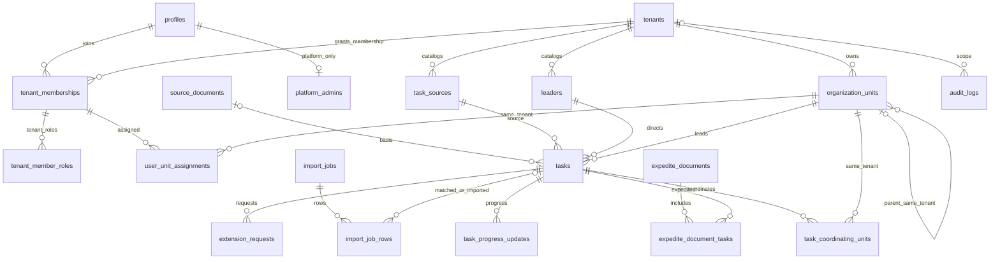

# B1 — Nền tảng D1 đa tenant, kiểm thử local

> **B1.2, 09/11/2026:** D1 TEST `theodoinhiemvu-d1-test` (UUID `649fd0db-7fd3-4551-bfac-f3fccc408373`) đã áp dụng đủ 5 migration. Có 20 bảng ứng dụng, đúng seed 11/3/3; không profile/task/tenant A/B. FK check và quick_check đạt; integrity_check bị D1 từ chối SQLITE_AUTH, không đánh dấu đạt. Chỉ chuẩn bị binding Preview local, chưa push/deploy/Auth/R2. [Báo cáo B1.2 và hướng dẫn Preview](../qa/D1_B1_2.md). Các trạng thái B1/A.2 cũ bên dưới là lịch sử trước B1.2.

Ngày 09/11/2026. Nhánh `feature/d1-multitenant-b1`, từ Preview đã nghiệm thu `feature/cloudflare-preview-clean`, commit nền `50d6b10fc842a95ad7f511de2df9792636d514a4`.

Chủ sản phẩm đã duyệt B1: tạo migration, seed danh mục và kiểm thử **D1 LOCAL**. A đã được nghiệm thu; B2 Auth thật, C quản trị và D nghiệp vụ thật chưa được phép triển khai. Chưa push/deploy, tạo database Cloud, chạy migration remote hoặc gắn DB thật vào Preview. UI và Worker entry Chặng A giữ nguyên.

## Chạy local

```powershell
npm run d1:migrate:local
npm run d1:list:local
npm run d1:inspect:local
npm run test:d1
npm run build
npm run test
```

`wrangler.d1-local.jsonc` dùng UUID **giả** `00000000-0000-4000-8000-000000000001`, binding DB, `remote:false`. Lệnh migration luôn có `--local`; DB nằm ở `.local/cloudflare/d1-local/v3/d1`. Đây là config công cụ D1, không dùng để serve/deploy frontend. Ứng dụng local vẫn chạy bằng config gốc và DEMO tại 8788; chưa đọc D1.

Tests dùng Wrangler migrations + `getPlatformProxy(remoteBindings:false)` trên workerd thật, không thay bằng SQLite Python hoặc mock D1. Mỗi lần chạy tạo state riêng `.local/cloudflare/d1-b1-tests/<UUID>`, giữ lại để kiểm tra; fixtures A/B không lẫn vào database danh mục local. `getPlatformProxy` dùng persist `<state>/v3` để chia sẻ đúng dữ liệu với Wrangler. Không đọc file môi trường hoặc mở remote bindings trong bộ test.

Helper runtime Microsoft app-local của Chặng A được dùng chung cho dev, `d1 --local` và test; kiểm tra hash, không cài phần mềm hệ thống/thay Windows. Không thêm dependency hoặc thay package-lock.

## Migrations và 20 bảng

| Migration | Nội dung |
|---|---|
| `0001_tenant_identity_and_administration.sql` | 10 bảng cơ quan/identity/quyền/danh mục/audit, cây tổ chức và audit append-only |
| `0002_business_foundation.sql` | 10 bảng nghiệp vụ, FK tenant và view hạn hiệu lực |
| `0003_integrity_guards.sql` | Bất biến ID/tenant/hạn gốc, snapshot hoàn thành, chốt gia hạn và phối hợp |
| `0004_huong_do_catalogs.sql` | Một tenant Hương Đô + 11 đơn vị + 3 lãnh đạo + 3 nguồn, một audit SYSTEM |
| `0005_reject_identity_replacement.sql` | Chặn INSERT OR REPLACE ghi đè ID/bỏ qua trigger UPDATE/DELETE |

Các file ở `cloudflare/d1/migrations`. SQLite `STRICT`, TEXT/INTEGER, CHECK, partial unique index, trigger và recursive CTE; không PostgreSQL/RLS/RPC/PLpgSQL, không `BEGIN/COMMIT` tự quản lý trong file migration. Wrangler quản lý thứ tự và ledger `d1_migrations`; chạy lại không seed trùng. Migration đã áp dụng giữ nguyên, thay đổi tiếp theo tạo migration mới.

| Bảng | Nội dung / khóa quan trọng |
|---|---|
| tenants | Cơ quan, code duy nhất, ACTIVE/SUSPENDED/ARCHIVED, cấu hình JSON |
| organization_units | tenant_id, parent_id cùng tenant, code duy nhất trong tenant, version/active/sort |
| profiles | Identity toàn cục theo cặp issuer/subject bất biến; không password/token/Auth user seed |
| tenant_memberships | Một profile tham gia tenant, trạng thái INVITED/ACTIVE/SUSPENDED/REVOKED |
| tenant_member_roles | Role thuộc membership cùng tenant; không chứa SUPER_ADMIN |
| platform_admins | Quyền nền tảng độc lập với membership/role tenant |
| user_unit_assignments | Membership và đơn vị cùng tenant; tối đa một phân công chính |
| task_sources | Nguồn theo tenant; code duy nhất trong tenant |
| leaders | Lãnh đạo theo tenant; code duy nhất trong tenant, không đồng nhất với tài khoản |
| audit_logs | PLATFORM hoặc TENANT, actor/profile/membership, trước/sau JSON, append-only |
| source_documents | Căn cứ DOCUMENT/MEETING/OTHER; số/ngày có thể trống với cuộc họp; nhiều task dùng chung |
| tasks | Nguồn, một chủ trì, lãnh đạo, hạn gốc, execution/progress, completion snapshot, version |
| task_coordinating_units | Liên kết task/unit cùng tenant, không trùng chủ trì, không nhân task |
| task_progress_updates | Ngày/nội dung/%/khó khăn/actor, tham chiếu task cùng tenant |
| expedite_documents | Văn bản hoặc nhắc nội bộ, số/ngày/nội dung, trạng thái hủy có lý do |
| expedite_document_tasks | Một văn bản nhiều task, PK tenant/document/task chống đếm trùng |
| extension_requests | Đề nghị, previous/proposed due, sequence, phản hồi/decision/approved due/actor |
| attachments | Metadata private key có tiền tố tenant; đúng một owner, mỗi owner có FK tenant |
| import_jobs | NHAP_NHIEM_VU/header 5, policy, idempotency theo tenant, người nhập/xác nhận |
| import_job_rows | Từ dòng 6, dữ liệu/lỗi JSON, quyết định trùng và task đích cùng tenant |

`v_tasks_effective` là view đọc tính hạn từ bản APPROVED mới nhất theo sequence, nếu chưa có dùng hạn gốc. Không có cột hạn hiệu lực trên tasks để PATCH tùy ý. View không phải endpoint công khai và không tự có quyền RLS.

## ERD và FK cần giữ khi triển khai B2/C/D



Mọi FK giữa bản ghi tenant dùng `(tenant_id, foreign_id)` → `(tenant_id,id)`, không chỉ một ID. Attachments có FK ghép riêng tới tasks/source/progress/expedite/extension/import, CHECK đúng một owner và document_role khớp owner; dùng nhiều FK tùy chọn thay vì entity_id không kiểm chứng. Import rows có FK ghép cả task nghi trùng và task đã ghi. Actor nhiệm vụ/văn bản là membership trong cùng tenant. Profiles/platform admin là toàn cục; không chứa dữ liệu nhiệm vụ tenant.

Audit `entity_type/entity_id` là dấu vết logic để giữ lịch sử, không FK đa hình tới mọi bảng. Worker mutation tương lai phải tự kiểm tra entity thuộc context; FK của audit vẫn kiểm tra tenant và cặp actor/membership/profile khi có membership. Không chuyển/xóa dữ liệu lịch sử bằng cascade. DELETE liên kết cha bị RESTRICT; ngừng hoạt động là cách mặc định của API tương lai.

## TreeView và danh mục Hương Đô

Tenant Hương Đô ID `tenant-huong-do`, code HUONG_DO. Đúng 11 đơn vị/3 lãnh đạo/3 nguồn lấy từ từng trường CSV, gồm cả kiểu chữ `CÔNG AN XÃ HƯƠNG ĐÔ`; ID catalog ổn định theo mã. Không seed người dùng, membership, platform admin, nhiệm vụ hoặc tài liệu giả vào DB danh mục.

Không có nguồn xác nhận quan hệ cấp trên của 11 đơn vị nên seed parent_id NULL; tên cơ quan gốc nằm ở tenants, không tạo đơn vị thứ 12. C có thể render tenant như node gốc ảo. FK parent cùng tenant, CHECK không tự làm cha và recursive CTE trigger chống vòng lặp dài khi thêm/sửa. ID/tenant bất biến, kể cả INSERT OR REPLACE. Di chuyển unit giữa tenant không phải thao tác cập nhật hợp lệ.

## Ma trận quyền chuẩn bị cho B2/C

| Vai trò | Quyền mặc định |
|---|---|
| Super Admin | Quản lý tenants, cấp Tenant Admin, audit nền tảng; **không tự có tasks:read của tenant** |
| Tenant Admin | Cơ cấu, membership, role, danh mục, audit tenant; không ngầm kế thừa Editor/Confirmer/Viewer |
| Office Editor | Xem/nhập/sửa task, tiến độ, đôn đốc, đề nghị gia hạn, báo cáo/tài liệu |
| Office Confirmer | Xem task/báo cáo/tài liệu, xác nhận hoàn thành, ghi quyết định gia hạn; không tự có tasks:write |
| Leader Viewer | Các capability đọc; không capability ghi |

Cấp nhiều role rõ ràng khi cần kết hợp. Phân công vào đơn vị không tự sinh role. Tenant Admin cần xem nghiệp vụ có thể được cấp thêm Viewer/Editor; không dùng role ADMIN cũ để mở mọi dữ liệu. Bootstrap Super Admin, invite/reset và cấp/thu hồi role thật thuộc B2/C, không tạo account đầu tiên ở B1.

`server/auth/permissions.ts` định nghĩa capability tách hai phạm vi. `authorization.ts` yêu cầu verifier phía server; thiếu verifier trả AUTH_NOT_CONFIGURED, không tin bearer chỉ decode, DEMO role hoặc tenant header. Khi B2 cung cấp verifier thật, phải kiểm tra chữ ký/issuer/audience/expiry/revocation trước khi dùng issuer/subject tra profile và membership. Một truy vấn D1 kiểm tra profile, tenant, membership active và role trong tenant.

Context nội bộ có brand Symbol, không tạo từ JSON client. Repository mẫu `server/data/tenant-tasks.ts` luôn bind tenant_id + task ID, kiểm tra lại active profile/tenant/membership và role đọc để chặn context cũ sau khi thu hồi. Không cache context giữa request. Super Admin context không dùng thay TenantContext. Các module này **chưa được nối vào router**; Worker vẫn chỉ mở health. B1 không phải nghiệm thu JWT/Auth hoặc CRUD thật.

D1 không có PostgreSQL RLS: DB binding ở Worker/CLI có khả năng đọc toàn DB. Không phát DB credential hoặc endpoint SQL cho client. FK ngăn liên kết sai, không ngăn một người vận hành DB đặc quyền đọc mọi tenant hoặc DROP trigger. Mọi endpoint B2/D phải áp dụng guard cho cả đọc/ghi/KPI/export/import/file; dữ liệu body chỉ là đề nghị, actor/tenant lấy từ context đã xác minh.

## Chốt nghiệp vụ và transaction

- Hạn gốc bất biến; hiệu lực chỉ từ lần APPROVED gần nhất. Pending/rejected không đổi hạn, chỉ một pending và sequence liên tục, kiểm tra previous_due snapshot. Trạng thái gia hạn DB PENDING/APPROVED/REJECTED được map sang nhãn V1.3 ở API D.
- Trạng thái tasks dùng đúng enum UI V1.3. 100% không tự hoàn thành. Completion bắt buộc ngày thực tế không tương lai, kết quả, actor và snapshot hạn đang áp dụng; phần completion sau xác nhận không sửa thường. Chưa hỗ trợ hồi tố gia hạn, giảm hạn hoặc đính chính completion đã chốt; cần workflow riêng có audit khi được duyệt.
- Đôn đốc đếm liên kết văn bản DOCUMENT/ACTIVE, không INTERNAL_NOTE/CANCELLED; một link duy nhất/task/document, sửa văn bản không tăng lượt. KPI tương lai dùng DISTINCT task ID trong tenant, group theo lead_unit_id.
- `DB.batch()` đã kiểm thử rollback toàn bộ nếu FK hoặc audit CHECK thất bại. Mutation B2/C/D phải gom thay đổi và audit trong cùng batch; dùng prepared statement, row_version/CAS và idempotency. Kết quả cập nhật 0 dòng không tự gây rollback: phải thiết kế guard/kiểm tra cạnh tranh trong transaction, không coi nhiều fetch rời là nguyên tử. B1 chưa có mutation API để tuyên bố đã hoàn tất phần này.
- Bảng attachments chuẩn bị metadata và FK, không upload R2. Quy tắc phải có file đề nghị/quyết định, MIME/scan/size/ready, quyền người ghi và xác nhận đủ số link phải được Worker D kiểm tra trong transaction; FK/CHECK đơn lẻ không chứng minh file đã upload. D1/R2 không chung transaction.
- Import chỉ chuẩn bị schema job/row/idempotency; chưa đọc Excel thật. Workbook 4 sheet, chỉ NHAP_NHIEM_VU header 5/data 6, 19 cột; không tự import VI_DU/DANH_MUC. Mã đối chiếu duy nhất theo tenant, mặc định SKIP; xác nhận chính sách và audit trước khi ghi.

## D1 TEST cho Preview — hướng dẫn thủ công, chưa thực hiện

1. Trong Cloudflare Dashboard, chọn đúng account → **D1 SQL database → Create Database** (có thể nằm trong nhóm Storage & databases), đặt tên **theodoinhiemvu-test** rồi Create. Đây là TEST riêng, không chọn database Production. Copy Database ID để đối chiếu; không cần tạo Auth user hoặc R2. [Các bước Dashboard chính thức](https://developers.cloudflare.com/d1/get-started/#2-create-a-database).
2. Sau khi chủ sản phẩm duyệt migration remote, dùng `wrangler.d1-test.example.jsonc` làm mẫu cho file **wrangler.d1-test.jsonc** (được ignore). Thay duy nhất placeholder bằng UUID TEST đã kiểm tra, giữ migrations_dir. File này là công cụ migration, không deploy Worker và không thay config Production.
3. Root `wrangler.jsonc` hiện **không thay đổi**, top-level không DB và previews.d1_databases vẫn rỗng. Khi được duyệt kết nối Preview, merge [mẫu binding](wrangler.d1-test.bindings.example.jsonc) vào **previews**: binding DB, tên/UUID TEST, migrations_dir. Không gắn DB ở top-level Production, không dùng database_id Production hoặc UUID giả local. Giữ assets/main ở cấp gốc. Cập nhật gate `check:preview` ở bước được duyệt để whitelist TEST; hiện gate cố ý chặn mọi DB.
4. Đối chiếu Workers & Pages → theodoinhiemvu → Previews Base/Preview cụ thể: DB phải trỏ TEST, không secrets/DB/R2 Production. Cấu hình repo và Dashboard phải thống nhất. Previews không tự được coi là an toàn chỉ vì tên nhánh khác main.
5. **Chỉ sau phê duyệt riêng**, đăng nhập đúng account, kiểm tra ID TEST rồi xem danh sách và apply bằng tooling config rõ ràng:

```powershell
# HƯỚNG DẪN TƯƠNG LAI — CHƯA CHẠY Ở B1
Copy-Item wrangler.d1-test.example.jsonc wrangler.d1-test.jsonc
# Thay REPLACE_WITH_D1_TEST_UUID, kiểm tra đúng TEST trước các lệnh sau.
npx wrangler d1 migrations list DB --remote --config wrangler.d1-test.jsonc
npx wrangler d1 migrations apply DB --remote --config wrangler.d1-test.jsonc
```

Không dùng config local để migration remote. Không chạy remote trong lượt B1. Không push/deploy Preview, deploy Production hoặc tự chuyển B2 khi chưa được phê duyệt.

Tham khảo kỹ thuật: [D1 migrations](https://developers.cloudflare.com/d1/reference/migrations/), [FK trong D1](https://developers.cloudflare.com/d1/sql-api/foreign-keys/), [D1 batch](https://developers.cloudflare.com/d1/worker-api/d1-database/), [Workers Previews configuration](https://developers.cloudflare.com/workers/previews/configuration/). Kết quả thực tế tại [báo cáo B1](../qa/D1_B1.md).
