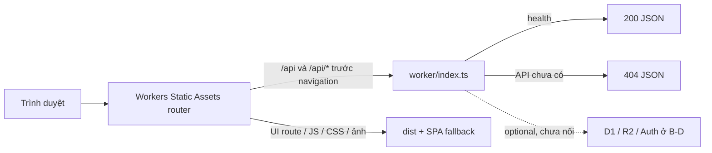

> **Kết quả Chặng A local.** Cấu hình env.preview/Preview riêng trong báo cáo này thuộc thời điểm A; A.2 đã thay bằng Worker Previews thật. Xem [báo cáo A.2](CLOUDFLARE_WORKER_PREVIEWS_A2.md) và [hướng dẫn hiện hành](../cloudflare/WORKER_PREVIEWS_A2.md).

# Nghiệm thu local Chặng A — Workers Static Assets + Worker API

Ngày 06/11/2026 theo [yêu cầu Worker](../cloudflare/STAGE_A_WORKERS_REQUEST.md). Đã lập trình/chạy thật trên workerd local. Không push, deploy Preview/Production, remote migration hoặc tạo D1/R2/Auth thật.

## Bảo toàn và cấu hình

Baseline HEAD `2e17c3c182f0ad1f3037c454600697ac3768ad7b`; giữ tài liệu chưa commit, không reset/checkout. Backup trước sửa: `backups/before-workers-stage-a-20261106-144013.zip`, 171 file, CRC đạt, SHA256 `e1861e6c5f0897a92f49d1c7cac3808802bff27da23294175f5a2c35dff49c88`. Nhánh local riêng **feat/cloudflare-workers-stage-a**, chưa commit/push thay đổi mới. [Archive Pages](../archive/2026-11-06-before-workers/README.md).

Node 22.14.0, Wrangler ghim 4.157.0, Workers types 5.20261104.1. Không dependency mới hoặc sửa Windows. Workerd dùng helper runtime Microsoft app-local đã chuẩn bị trước; không Node API thay thế.

## Vì sao health trả HTML

HTTP chỉ đọc tại `https://theodoinhiemvu.ntuan161297.workers.dev/api/health` với `Sec-Fetch-Mode: navigate` nhận **200 text/html**, title “Theo dõi nhiệm vụ · UBND xã Hương Đô”, cùng HTML trang chủ.

Local trước sửa dùng Pages (`pages_build_output_dir`, `functions/api`), không có Worker entry/Workers assets config. Pages Functions không tự trở thành API Worker khi chỉ upload frontend. Thêm nữa, SPA fallback Workers có thể phục vụ index.html cho navigation nếu API chưa được đặt Worker-first. [Cloudflare giải thích hành vi navigation và cách ưu tiên Worker](https://developers.cloudflare.com/workers/static-assets/routing/single-page-application/).

Đã xác minh triệu chứng HTTP và xung đột kiến trúc local. Chưa truy cập Dashboard/code Cloud nên không khẳng định bản Production thiếu entry hay chỉ thiếu Worker-first. Bản sửa local xử lý cả hai: entry Worker thật và `run_worker_first=["/api","/api/*"]`. Production chưa nhận sửa đổi.

## Kiến trúc cuối cùng



Không Pages Project, Functions hoặc Cloudflare Vite plugin. Worker `theodoinhiemvu`, main `worker/index.ts`, compatibility date 2026-11-06, ASSETS binding. `DB`/`DOCUMENTS` optional chưa gắn. Health GET/HEAD; method khác 405; API chưa có 404. Không trả giả dữ liệu nghiệp vụ. UI giữ DemoProvider/login; Vercel nguyên trạng.

## Kết quả kiểm thử

| Kiểm tra | Kết quả |
|---|---|
| `npm run build` | Đạt: strict TypeScript frontend/Worker + Vite |
| `npm run build:worker` | Đạt: Wrangler bundle/dry-run, không upload |
| `npm run test` | **28/28**: 14 domain cũ + 7 service + 7 Worker |
| `npm run test:ui:worker` | **9/9**, 50,8 giây, Edge headless trên workerd |
| UI regression | 7 bài cũ: desktop/tablet/mobile, forms/Drawer/filter/KPI, tiến độ/hoàn thành, đôn đốc/gia hạn, import DEMO/viewer/CSV |
| API integration | Fetch cùng origin, browser navigation thật, header navigate, HEAD/405/404; API miss không fallback HTML |
| Static/UI | Sáu route direct/reload 200; JS/CSS/ảnh/favicon đúng MIME, không nhận response API |
| Cảnh báo còn lại | Bundle React lớn >500 kB, có từ trước, không chặn build |

UI bundle giữ nguyên `index-B4hA_eH3.js` và `index-Bd-Zx4Gg.css`. Các file UI/domain/domain tests không đổi so với backup.

## HTTP thực tế tại 127.0.0.1:8788

| Request | Status | Content-Type |
|---|---:|---|
| GET `/api/health` fetch hoặc navigate | 200 | application/json; charset=utf-8 |
| Browser mở `/api/health` | 200 | application/json; charset=utf-8 |
| GET `/api/khong-ton-tai`, kể cả navigate | 404 | application/json; charset=utf-8 |
| POST/PUT/PATCH/DELETE/OPTIONS `/api/health` | 405 | application/json; charset=utf-8 |
| HEAD `/api/health` | 200, không body | application/json; charset=utf-8 |
| Direct/reload `/tong-quan`, `/nhiem-vu` và bốn UI route còn lại | 200 | text/html; charset=utf-8 |

API có no-store/nosniff, request ID tự sinh. Body health tối giản, không lộ env/secrets:

```json
{"status":"ok","service":"theo-doi-nhiem-vu-api"}
```

Bằng chứng HTTP `.local/cloudflare/worker-http-checks.json`, logs `.local/cloudflare/logs/worker-server.*.log`, ảnh `.local/cloudflare/worker-qa`. Không ghi đè ảnh nghiệm thu cũ.

## File tạo/sửa và phần còn mô phỏng

[Danh sách đầy đủ 59 file thay đổi so với backup trước lượt Worker](CLOUDFLARE_WORKERS_STAGE_A_FILES.json), bao gồm file archive và file chuyển khỏi cây active. Danh sách này phân biệt thay đổi trong lượt hiện tại với tài liệu đã chưa commit từ trước. Kiểm tra 21 file được bảo toàn (UI/domain/tests nghiệp vụ, package-lock, Vite, Vercel): không thay đổi hash; 16 tài liệu entry/prompt không có liên kết nội bộ bị hỏng; master hợp nhất vẫn đủ 10 mục.

Tạo `worker/index.ts`, `tsconfig.worker.json`, `playwright.worker.config.ts`, `tests/worker/{health.test.ts,infrastructure.spec.ts}`, yêu cầu Worker nguyên văn, báo cáo này và archive Pages; prompt A mới `01A_CLOUDFLARE_WORKERS_HA_TANG.md`.

Sửa `wrangler.jsonc`, `package.json`, `shared/api.ts`, `server/{env.ts,http.ts}`, `src/services/{api.ts,api.test.ts}`, `scripts/wrangler-local.mjs`, `vitest.config.ts`. Đổi helper thành `scripts/prepare-worker-runtime.ps1`, nội dung giữ nguyên. **Không đổi package-lock, Vite config, vercel.json hoặc UI/domain/domain tests.**

Chuyển vào archive, bỏ khỏi build/test: `functions/api/*`, `public/_routes.json`, `tsconfig.functions.json`, `playwright.pages.config.ts`, `tests/functions/health.test.ts`, `tests/pages/infrastructure.spec.ts`. Chức năng API hạ tầng chuyển sang Worker và được kiểm thử lại.

Đồng bộ README gốc/README_BAT_DAU, kế hoạch, master/truy vết/hướng dẫn Cloudflare, prompts, các entry/banner công nghệ trong product/analysis. Không sửa thân quy tắc nghiệp vụ hoặc Supabase SQL. [Master gốc](../archive/2026-11-06-before-workers/docs/cloudflare/MASTER_PROMPT.md) và [yêu cầu mới](../cloudflare/STAGE_A_WORKERS_REQUEST.md) bảo toàn nguyên văn.

Đã hoạt động thật: frontend + health cùng Worker local, JSON routing/errors, static/SPA và API service. Vẫn mô phỏng: login/vai trò, thay đổi nhiệm vụ trong phiên, file/import/đôn đốc/gia hạn. Chưa Auth, D1 migration, tenant isolation/RBAC, R2, persistence; B–E chưa bắt đầu.

Mở **http://127.0.0.1:8788/** để nghiệm thu. [Hướng dẫn Preview và thao tác thủ công](../cloudflare/README.md). Dừng chờ duyệt local trước Preview, chưa push/deploy/migration remote và không tự chuyển B.
